# AURORA user manual

AURORA turns the raw folders of an SGM beamtime (ambxas endstation, Canadian Light Source) into quality-checked
spectra, comparisons, fits, maps and a report. AURORA is version 2 of John Bussey's SGM XAS GUI, based on James J.
Dynes' SGM_Beamline_Analysis notebooks. This manual describes every perspective and every control. The short version
is `USER_GUIDE.md`; step-by-step walkthroughs are in `TUTORIALS.md`; installation is in `INSTALL.md`. All four open
from the **Help** menu.

Nothing is ever written into `raw/`. Everything AURORA produces lives in `<project>/.aurora/` (session, backups and
caches), in `processed/reduced/` when Check saves spectra, in the output folder chosen for a report, or in files
exported explicitly.

Conventions: a name in bold is a control as it reads on screen (a button, a check box, a menu entry, a tab, a card
title); *italics* quote text that AURORA shows (a status line, a note, a list entry).

Contents

1. [The window](#1-the-window)
2. [Home](#2-home)
3. [Survey](#3-survey)
4. [Reduce](#4-reduce)
5. [Check](#5-check)
6. [Compare](#6-compare)
7. [Fit](#7-fit)
8. [Maps](#8-maps)
9. [Report](#9-report)
10. [Settings](#10-settings)
11. [Command line](#11-command-line)
12. [Files AURORA reads and writes](#12-files-aurora-reads-and-writes)
13. [Troubleshooting](#13-troubleshooting)

---

## 1. The window

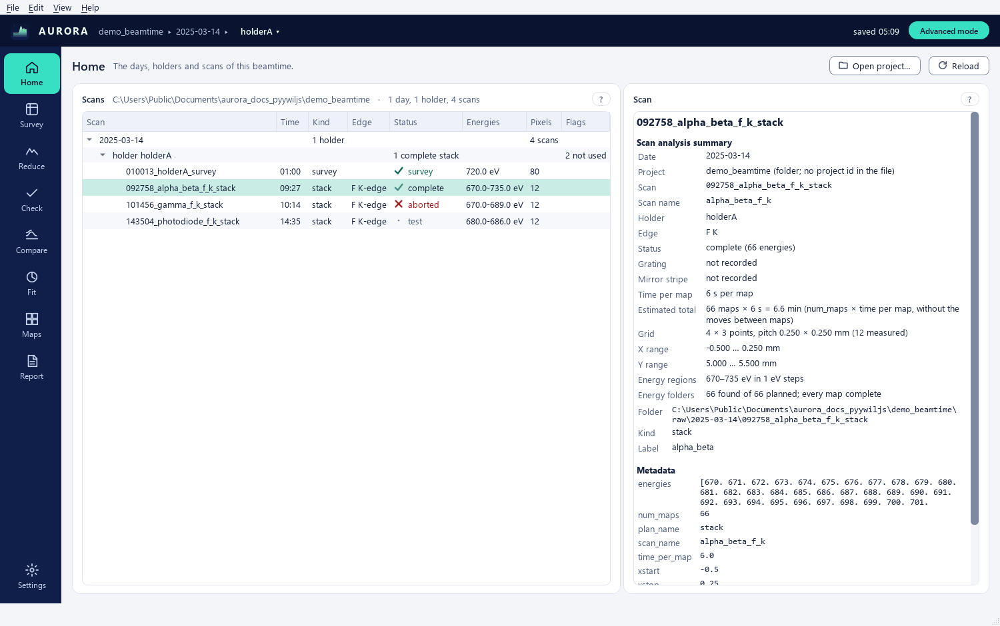

- **Top bar**: the AURORA mark, the crumb *project ▸ day ▸ holder ▾*, the save indicator and the mode button
  (**Easy mode** or **Advanced mode**). Click the holder part of the crumb to choose another holder of the project;
  each entry reads like *N5 · 2026-11-05 · 1 stack · 2 zones*. **Ctrl+PgUp** and **Ctrl+PgDown** step to the previous
  and next holder, wrapping around. The save indicator reads *unsaved* while a change waits for the autosave (it is
  written within a second), *saved 12:03* once it is on disk, and *read-only* when the session cannot be saved (a
  session.json written by a newer AURORA, the project open in another AURORA, a folder that cannot be written); it is empty until the project has a session file.
- *Rail* (left): the eight perspectives, **Home** to **Report**, in the order of a normal workflow; **Ctrl+1** …
  **Ctrl+8** open them, and the tooltip of each rail button names its shortcut. **Settings** sits at the bottom.
  Every perspective keeps its state when you switch.
- **Cards**: every panel has a title and a small **?** that opens this manual at the panel's section. **F1** (**Help
  on this page**) opens the section of the current perspective, or of the current tab in Fit and Maps.
- *Empty panels* say what to do next, with a button for it (**Open project…**, **Open the demo beamtime**, **Go to
  Reduce**, **Go to Compare**, …). A button that cannot act yet is greyed, and its tooltip says why (*open a project
  first*, *tick at least two rows 'Fit' in Compare*).
- **Ctrl+Return** clicks the highlighted (primary) button of the current perspective, for example **Add to Check** or
  **Build the report**.
- **Status bar**: the last thing AURORA did (zones saved, files written, report built, …).

### 1.1 Easy and Advanced mode

AURORA starts in **Easy mode**, the basic path of John Bussey's SGM XAS GUI: open the beamtime, draw the samples in
Reduce, check the spectra, compare them, fit them with LCF, build the report. Easy mode shows the controls of that
path and states the values it uses where they matter (for example *± from 200 bootstrap draws* in Fit). **Advanced
mode** shows every option and the Maps perspective. Three entry points switch the mode, and all three do the same:
**View > Advanced mode**, the mode button at the right of the top bar, and **Ctrl+Shift+A**; the Settings check box
*advanced mode* is a fourth. The status line confirms the mode (*Easy mode: the basic path of John Bussey's GUI* or
*Advanced mode: every option*), and the choice is kept for the next start.

Switching never changes a value and never writes the session: a value chosen in Advanced mode stays in force in Easy
mode, and Easy mode says so where it matters (the chip *advanced settings in use* in Reduce, *chosen in Advanced mode*
in Report).

| Perspective | Easy mode | Advanced mode adds |
|---|---|---|
| Home | the scan tree, the project summary and the scan analysis summary | the Kind column, the folder, kind and label rows, the sgm_report notes, the full table of h5 attributes, the SDD geometry, the full error of a failed open |
| Survey | the holder, the plate map with footprints and zones, the footprint legend, the sketch, the sample-sheet rows | channel, SDD, **/ I0**, **log**, **invert**, clip, **footprints**, **zones**, **Import zones…**, **Export zones…**, **Grid of zones…** |
| Reduce | the four numbered steps: **Scans of holder N5**, **XRF window** (preset, lo, hi), **Region** (**navigate**, **rect+**, **lasso+**, **Clear**, **New sample**, **Delete**, the sample label), **Reduce** (the settings line, **Add to Check**); the **Preview** with **all scans of the sample** | **Load all**; **polygon+**, **rect-**, **brush+**, **brush-**, the brush size, **rect+ starts a new zone**, the show row; spectrum of, **same range for all detectors**, for, **Remember windows for F K**; group, comment, **Send the zone's traces to Compare**, **Rules…**, **Propose zones**, **Stitch…**, **Load polygon…**, **Save polygon…**; the per-scan settings cards with **Copy to…**; the preview toggles |
| Check | **Spectra to check** (**Tick all**, **Untick all**, **Save ticked → Compare**) and **Preview of the selected spectrum** | **Scans of holder N5** (**Run the checks on holder N5**, **Run the checks on every holder**), **I0 of the holder's scans (per-pixel mean)**, **The four detectors on the selected zone**, the I0 explorer |
| Compare | the columns Show, Fit, Label, Signal, Shift eV and Colour; **Add saved spectra…** (John Bussey's files only); **Figure size…**; **Export…**; x range; **Remove**, **▲** **▼**, **Show all**, **Hide all** | the Norm, Pre / Post, E0, E0 eV, Flatten, Spacing, Scale and Diag columns; **Add CSV…**, **References…**, **Save config…**, **Load config…**, **Remove sample**, **Rename**, **Duplicate**; default shift for new rows; the windows row; the plot options; the peaks |
| Fit | the **LCF** tab with its fixed options stated; **Figure size…** | the **PCA / MCR-ALS**, **ITFA** and **Peaks** tabs; the LCF options (**force coefficients to sum to 1**, **allow negative coefficients**, bootstrap, resample) and the uncertainty and F-test detail |
| Maps | not shown (**Ctrl+7** says *Maps is part of Advanced mode (Ctrl+Shift+A)*) | the whole perspective |
| Report | **Options** (title, output, author, what the report covers, **Build the report**), **Check before building** (**Findings**, **Contents**), **Pages** | preset, PNG, **Appendix A: the four detectors per zone**, **Appendix B: plate maps with the zones**, the **Scope** tab |
| Menus | every entry except those on the right | **File > Restore zones from a backup…**, **File > Re-reduce the stack with the project ROI bins**, **Edit > History…** (and **View > Go to > Maps**) |
| Settings | appearance, text size, report author, the last project at start, advanced mode, the update check | the de-spike threshold, the two default normalisations, the map colour map, the reference spectra folder |

### 1.2 Appearance, long tasks and exports

**Appearance and text size.** **View > Appearance** is **Follow the system**, **Light** or **Dark**; **View > Text
size** is **Normal**, **Large** or **Larger** (13, 15 or 17 px); both apply at once, without a restart, and are also
in Settings. The map area, the rail and the top bar stay navy in both schemes, so colour maps look the same in both. A
curve keeps its colour when the scheme changes, and every curve also has its own dash, so colour is never the only
cue. Status cells show an icon with a word (*✓ ok*, *! check*, *✗ bad*). A focused control shows a 2 px outline.
Every intensity map (Survey, Reduce, Maps) has its colour scale beside it, named by its quantity (*counts / I0*,
*log10(counts / I0 + 1)*). Footprint and zone outlines sit on a dark edge and a light rim of their own hue, so
they read on every tone of the colour map.

*Long tasks* (reading a project, loading stacks, reading XRF windows, running the checks, fits, loading a
hypercube, clustering, exports, building the report) run in the background behind a progress strip: the bar, the
current step, the elapsed time and **Cancel** (**Esc**). A cancelled task stops at its next step and leaves nothing
half-written (no cache, no partial report). A task that fails says so in its strip and opens one error dialog with the
details (**Copy details**, **Open log folder**). Closing the window cancels the running tasks and waits a few seconds
at most.

*Exports and file dialogs* start in a sensible folder: the last folder used for that kind of file, else the
project's `reports/` folder (or the matching project folder), else the project, else Documents. After an export the
message line lists the files written, with an **Open folder** link. A file that cannot be written (open in another
program, no permission) gives one calm dialog that names it.

### 1.3 Menus and keyboard shortcuts

- **File**: **Open project…** (**Ctrl+O**: a beamtime folder, a loose folder of scans or a scan folder), **Reload**
  (**F5**), **Restore zones from a backup…** (Advanced), **Open recent** (the last ten projects, then **Clear list**),
  **Re-reduce the stack with the project ROI bins** (Advanced; enabled when the current stack comes from an sgm_report
  cache reduced with other windows, see 4.2), **Settings…**, **Quit**. A folder or an .h5 file dropped on the window
  opens it too.
- **Edit**: **Undo** (**Ctrl+Z**) and **Redo** (**Ctrl+Y** or **Ctrl+Shift+Z**), each naming the edit (*Undo add a
  rectangle to zone 3*); **History…** (Advanced) lists every edit since the project was opened, and a click on a line
  goes back to that point.
- **View**: **Advanced mode** (**Ctrl+Shift+A**), **Appearance**, **Text size**, **Previous holder** (**Ctrl+PgUp**),
  **Next holder** (**Ctrl+PgDown**), **Go to** (**Ctrl+1** … **Ctrl+8**; Maps only in Advanced mode), **Full screen**
  (**F11**).
- **Help**: **User guide**, **Manual**, **Tutorials**, **Installation and sharing**; **Help on this page** (**F1**);
  **Keyboard shortcuts** (**Ctrl+/**, generated from the window, so it always lists every shortcut); **What's this?**
  (**Shift+F1**, then click a control to read what it does); **Open the demo beamtime**; **Run self-test…** (checks
  every part of this installation on a synthetic beamtime in the background, then shows the summary with **Copy** and
  **Open folder**; see INSTALL §4); **Report a problem…** (what to send, **Copy diagnostics** with the versions, the
  project, the settings location and the last 200 log lines, **Open the log folder**, and the GitHub issues
  address as a link; the issues are public, so the diagnostics write the home folder as ~ and the dialog asks you to read them before posting); **Check for updates…** (asks GitHub whether a newer AURORA exists, or says that no release is published yet; nothing is downloaded or installed);
  **Licences…** (AURORA's MIT licence, the credits, the third-party licences); **About AURORA**.

Keyboard shortcuts (**Help > Keyboard shortcuts** lists the same table, generated from the window). The keys are
written with their Windows and Linux names. On macOS, Ctrl is ⌘ (Command) and Alt is ⌥ (Option), the Mac delete
key also deletes a sample, and the Help window, tooltips and messages show the Mac keys:

| Section | Keys |
|---|---|
| File, Edit, View | **Ctrl+O** open, **F5** reload, **Ctrl+Z** undo, **Ctrl+Y** / **Ctrl+Shift+Z** redo, **Ctrl+Shift+A** Advanced mode, **Ctrl+PgUp** / **Ctrl+PgDown** previous / next holder, **F11** full screen |
| Go to | **Ctrl+1** Home, **Ctrl+2** Survey, **Ctrl+3** Reduce, **Ctrl+4** Check, **Ctrl+5** Compare, **Ctrl+6** Fit, **Ctrl+7** Maps (Advanced), **Ctrl+8** Report |
| Help | **F1** help on this page, **Ctrl+/** keyboard shortcuts, **Shift+F1** what's this |
| General | **Esc** cancel the running task, **Ctrl+Return** the main action of the page |
| Reduce | **V** navigate, **R** rect+, **L** lasso+, **E** rect- (Advanced), **B** brush+ (Advanced), **Shift+B** brush- (Advanced), **P** polygon+ (Advanced), **+** / **-** brush size (Advanced), **N** new sample, **Del** delete the sample, **Alt+Up** / **Alt+Down** previous / next sample, **[** / **]** previous / next scan, **F** fit the view, **Ctrl+Shift+C** / **Ctrl+Shift+V** copy / paste the scan settings (Advanced) |

The shortcuts of Advanced tools do nothing in Easy mode.

### 1.4 The session: saving, undo and backups

One *session* is attached to the open project: the current holder, the zones of every holder, the per-scan settings
of every zone, the good-I0 choices, the saved rules and the view memory. It is saved automatically to
`<project>/.aurora/session.json` within a second of every change, and only when something changed: opening a project
and looking at it writes nothing. Every change to zones, settings or good-I0 can be undone (the last 100); a brush
stroke, or a run of edits of the same kind less than 1.5 s apart, is one step, and so are **New sample** with the
first rectangle drawn into it, one **Propose zones**, one import and one restore. The undo history lives in memory
and ends when AURORA closes. **Reload** (**F5**) keeps the holder, the zone and the stack on screen, the stacks already
read (unless their folder changed) and the undo history; new holders are added at the end.

The session is never lost: session.json is replaced in one step (a crash mid-way leaves the previous file), the
previous good file is kept as `session.json.bak`, and a copy goes to `.aurora/backups/` at most every 10 minutes while
you edit and before every import, proposal, rule application and restore (the last 30 are kept). A damaged
session.json is kept as `session.corrupt-<time>.json` and the zones come back from the newest readable state (the .bak or a backup);
a message says how many zones were restored and from when. **File > Restore zones from a backup…** (Advanced) lists
the backups (columns Saved, Kind, Holders, Zones, File) and **Restore** brings one back; a restore is itself one undo
step. A session.json written by a newer AURORA opens read-only: the zones are shown, edits stay in memory, and the
status line says *written by a newer AURORA: edits here are not saved; export them to a file*.

One AURORA at a time edits a project: the first to open it holds `.aurora/session.lock` (its process, computer, user
and time). Another AURORA, on this computer or on another one over a shared folder, opens the project read-only and
names the one that holds it; close that one, then **Reload**. The lock of an AURORA that has ended, or has not been
heard from for 10 minutes, is taken over. A project whose session cannot be written (a protected or read-only folder,
a read-only session.json) opens read-only too, and says why. A session.json changed on disk by another program is
kept in `.aurora/backups/` before AURORA writes over it. When edits could not be saved (a read-only session, a failed
save), closing the window or opening another project asks first: **Export zones…** writes them to a zones_all.json
of your choice (in Easy mode too), *Discard* goes on without them, *Cancel* stays.

The Compare library is saved with the project too, in its own files (6.1); it is not part of the undo history.

Vocabulary used throughout:

| Term | Meaning |
|---|---|
| project | a beamtime folder containing `raw/` (and usually `processed/`, `config/`, `reports/`), or a loose folder of scan folders |
| day | one `raw/<YYYY-MM-DD>/` folder |
| holder | a plate on the manipulator; a survey scan starts a holder, the stacks that follow belong to it (across midnight too) |
| survey | one energy over the whole plate (`<time>_<name>_survey`) |
| stack | the XAS map: n energies × m points (`<time>_<name>_<edge>_stack`) |
| zone, sample | an area of the plate in mm (rectangles, polygons, painted pixels, erased areas) that becomes one spectrum per scan; Easy mode calls it a sample |
| group | the sample-sheet group of a zone; the report is organised by group |
| line | an emission window in the SDD spectrum: F Kα, O Kα, … from `config/roi_bins.json`, the total XRF, or custom XRF windows |
| I0 | the Au-mesh current (mcc channel 1); the photodiode is channel 2, TEY channel 4 |

## 2. Home

Open a beamtime with **File > Open project…**, the **Open project…** button, **File > Open recent**, by dropping a
folder or an `.h5` file on the window, or from the command line (`aurora <folder>`). Five kinds of path open:

- the beamtime folder that holds `raw/<day>/<scan>` (the usual choice), or the same day folders without `raw/` (a copy
  that left that level out);
- one day or scan folder of a beamtime: that day opens alone. The path line says so (*2026-11-03 only (1 of 4 days)*)
  and **Show every day**, next to **Reload**, opens the whole beamtime;
- a loose folder of scan folders, the way John Bussey's GUI kept them (`CLS GUI/<scan folders>`). It is a project of
  its own: its `.aurora/` folder is written inside it. Each scan's day is the date its `.h5` file was written (the
  `file_creation_timestamp_iso` attribute, else the date in the file name, else the folder name);
- one scan's `.h5` file, dropped on the window or given on the command line (the folder dialog of **Open project…**
  lists folders only): the project of its scan folder opens, that day alone.

The folder is read in the background: a share that does not answer never blocks the window. The tree lists days,
holders and scans:

| Column | Meaning |
|---|---|
| Scan | the scan name without its time prefix |
| Time | HH:MM of the scan folder |
| Kind | survey, stack, other (Advanced) |
| Edge | the target edge read from the plan and the name (F K, O K, Se L3/L2, …) |
| Status | complete, in progress, aborted, test |
| Energies | first–last eV and the number of energy folders |
| Points | pixels per energy |
| Flags | from the sgm_report summary and AURORA's own checks when present: saturated SDDs, high count rate, I0 invalid |

Status rules: *complete* when every planned energy folder is there; *in progress* when folders are still arriving
(touched within the last 25 min); *aborted* when fewer energies than planned and untouched for 25 min; *test* when
the span is under 5 eV or the name says photodiode, dark or beam test. Test stacks are hidden from zones but stay
available in the I0 explorer of Check.

**After midnight.** Holders are followed across days: a stack recorded after midnight, before the next survey,
belongs to the holder of the previous day. It is listed under that holder with *(next day)* after its time, and the
row of its own day says *continues holder N5*. A survey always starts a new holder; a survey re-taken on the same day
before any stack replaces the earlier one. *unknown* appears only for stacks recorded before any survey of the
project.

Double-click a scan to open it in Reduce. **Reload** rescans the folder (new scans arriving during a beamtime appear
without reopening). The sgm_report `summary.json` of a day, when present, feeds the flags and the zone proposals.

Calibration (`sdd_calibration.json`) is taken from a sibling `SGM_Beamline_Analysis-main/` folder when there is one
(where sgm_report keeps the live file), otherwise from `config/`; the one used is printed by `aurora project`.

The sample sheet is the first CSV at the root of the project that parses (cp1252, columns `Final plate#`,
`Sample group`, `Sample ID`, …). Its sample IDs are offered as zone labels when the plate column equals the holder
name; its groups are offered for every zone.

### 2.1 Opening a project

Before a project is open, Home shows three buttons, **Open project…**, **Open the demo beamtime** and **Read the
tutorials**, and the list **Recent projects** (the last ten). Double-click a recent project to open it. A project that
is missing or on a share that is not reachable now is greyed and marked *(not found)*; it can still be tried.
Right-click an entry for **Open** or **Forget**. **File > Open recent** lists the same ten projects, with **Clear
list** at the bottom (the folders themselves are never touched).

When a folder cannot be opened, Home says *Could not open the project*, names the folder and the reason (the folder
does not exist or its share is not reachable; access denied; not a beamtime; a file that is not a scan's `.h5`, such as
a detector `.bin`, a `.zip` to extract first or any other file), and offers **Retry** (not for a file) and **Choose
another…**. When another project was already open, **Keep the open project** closes the note and keeps it. In Advanced
mode the panel on the right also shows the full error.

At start, AURORA reopens the last project when *open the last project at start* is on (Settings); if that fails, the
path line says so in one sentence (*the last project, my_beamtime, could not be opened: the folder does not exist, or
the share that holds it is not reachable now. Pick another one below.*) and the welcome page stays.

### 2.2 Project and scan summaries

With a project open and no scan selected, the panel on the right is the **Project** summary: folder, layout (raw
folders or a loose folder of scans), days, holders, scans by status (survey, complete, in progress, aborted, test),
stacks that continue a holder after midnight, the SDD calibration file used (or *none found: the default gain is
used, not calibrated*), the ROI bins found in `config/roi_bins.json`, the sample sheet found (name and number of
samples) and `config/plate_layout.json` when present.

Selecting a scan shows its **Scan** panel, the scan analysis summary John Bussey's GUI printed:

| Row | Meaning |
|---|---|
| Date | the scan's day (for a stack after midnight: the holder it continues) |
| Project | the project id recorded in the file (`project`), else the folder name |
| Scan, Scan name | the folder name and the plan's `scan_name` |
| Holder, Edge, Status | as in the tree |
| Grating, Mirror stripe | `grating_selection` / `grating` and `mirror_stripe` / `stripe` of the file |
| Time per map | `time_per_map`, for example *3 s per map* |
| Estimated total | `num_maps` × time per map, without the moves between maps |
| Grid | nx × ny points, the pitch in x and y (mm) and the number of points measured |
| x range, y range | first and last point centre (mm) |
| Energy regions | the planned energies as regions of constant step, for example *680–685 eV in 0.5 eV steps; 685–700 eV in 0.1 eV steps; 700–730 eV in 0.2 eV steps* |
| Energy folders | found vs planned, the planned energies without a folder, and the incomplete maps (a map with fewer points than the grid, SDD files shorter than the mcc file, or a missing file), checked in the background |
| Flags | from the sgm_report summary and AURORA's own checks |

A survey shows its energy instead of the time and energy rows. Advanced mode adds the folder, kind and label, the
sgm_report notes, the full table of h5 attributes and the SDD geometry for the date.

## 3. Survey

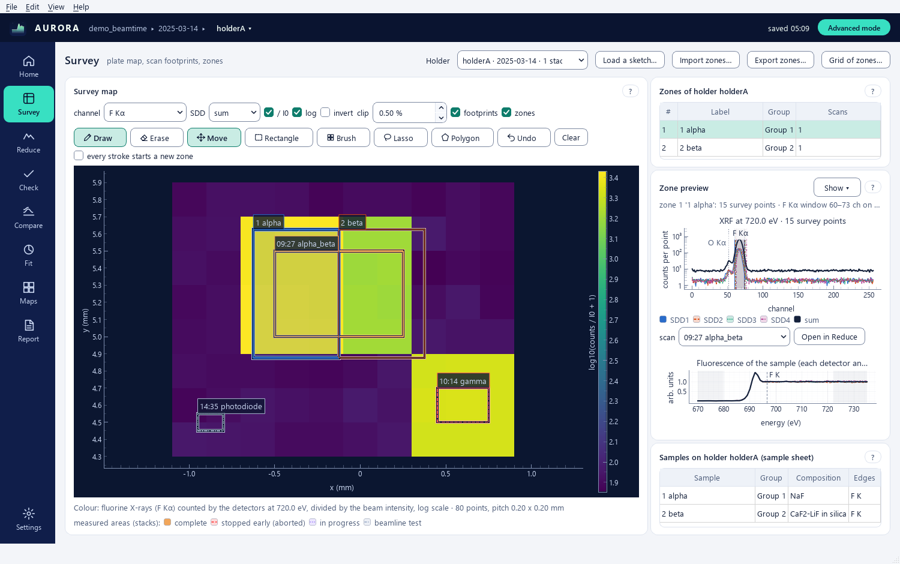

The **Survey map**: the plate map of the holder chosen in the **Holder** list (or in the top bar).

- **channel** (Advanced): a fixed emission line, total XRF, TEY or I0. **SDD**: sum or one detector.
- **/ I0** divides by the mesh current when the survey's I0 is usable. **log** shows log10. **invert** flips the
  scale for high-energy surveys where samples are darker than the plate. **clip** trims the colour range at both
  ends (0.5 % by default). All Advanced.
- **footprints**: the stacks of the holder, one colour and dash per status (complete, aborted, in progress, test; the
  legend sits under the map in both modes). Click one to open it in Reduce. **zones**: the zones of the holder with
  their labels.
- Hovering prints x, y and the value under the cursor.
- The cards on the right show **Zones of holder N5**, the **Sketch** of the holder (`zones_html/sketches/<holder>.png`
  when it exists) and the **Samples on holder N5 (sample sheet)**: the rows of the sample sheet that belong to it.
- **Import zones…** (Advanced) reads a zones_all.json (the browser zone tool's, or another AURORA's export or
  session). For a holder that already has other zones, the **Import zones** dialog asks what to do, per holder, in the
  column **What to do**: **Merge** (the default: the file's zones are added with free numbers, and a zone with the
  same rectangles, erase rectangles, painted pixels and polygons as one already here is skipped as a duplicate),
  **Replace** (the file's zones replace the holder's) or **Skip**; **Import** applies the choices. Holders with no
  zone here are simply added, and a file whose zones are exactly the ones here asks nothing. A backup of the session
  is saved first; the status line reads *imported 12, skipped 3 duplicates, backup saved as
  session-20261108-101500.json*, and **Ctrl+Z** undoes the whole import. A file that cannot be read changes nothing
  and a message names it (a rectangle or painted square needs 4 numbers, a polygon vertex 2). A holder of the file
  is matched to this project's by its key, else by its holder name and day, else by its name alone when only one
  holder has it; the zones of a holder this project does not have are kept but not shown, and the status line counts them.
- **Export zones…** (Advanced) writes the browser zone tool's zones_all.json for the whole project (every holder):
  version 1, without AURORA's header, `ui` and `rules` blocks. Polygon zones are written as painted squares on the
  pixels inside them, at the pitch of every stack, so the tool finds the same members; AURORA keeps the polygon itself.
- **Grid of zones…** (Advanced) cuts a block of pads into zones; see 3.1.

### 3.1 Grid of zones (Advanced)

Click **Grid of zones…**, then drag a rectangle over a block of pads on the plate map (click the button again to
cancel). The **Grid of zones** dialog opens; the zones show dashed on the map, and the cells that will be skipped
dotted, until **Accept** adds them to the holder in one step (one undo step: *grid of N zones*).

| Control | Effect |
|---|---|
| layout group | the group of `config/plate_layout.json` for this holder whose rows, columns and sample names fill the grid. The group whose match words fit the scans under the rectangle is chosen first (sgm_report's rule: the longest match word wins) |
| rows, columns | the grid as seen on the map |
| cell fill | each zone covers this share of its cell's width and height, centred in the cell (70 % by default) |
| rotation | how the plate sat in the holder compared with the layout, counter-clockwise: 180° for a plate mounted upside down reverses the order of the labels |
| labels from | *layout cells* (the sample names of the group; an empty position of the layout is skipped), *sample sheet rows* (the holder's rows in reading order, top row first, with their groups), or *zone numbers* |
| first sheet row | the sample-sheet row that labels the top-left cell |
| snap to pads | shrink each cell to the bright survey pad inside it (Otsu threshold of the survey map, as **Propose zones** does); cells without a pad are skipped |

The line under the controls counts the zones and lists the skipped cells (*row 2, col 2 (no pad)*). Zones are
numbered after the zones of the holder; their group comes from the sample sheet, else from the layout group's name.
After **Accept**, the line under the map says what was added and skipped (*added 5 zones to holder N5; skipped row 2,
col 2 (empty on the layout)*).

## 4. Reduce

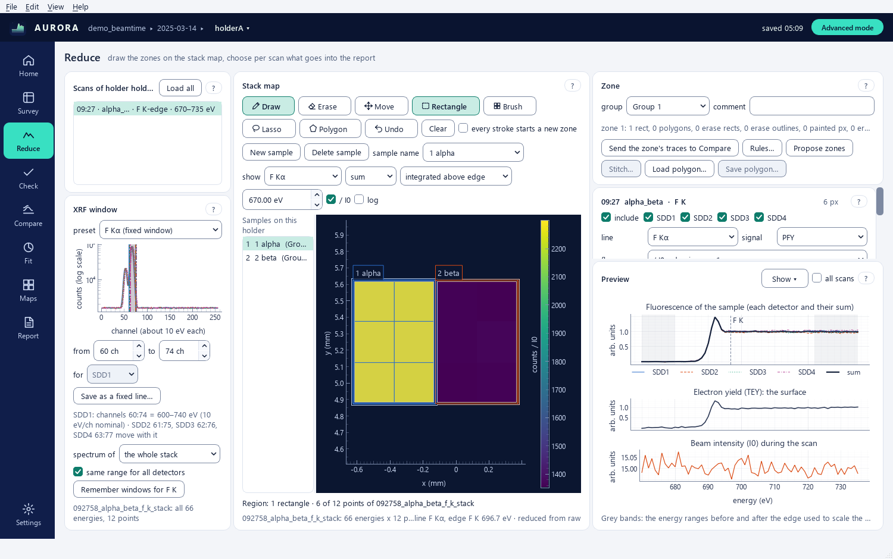

Reduce is the zone tool: zones (samples) are drawn on the stack map of one scan, in mm, so that every scan of the
holder that covers the area attaches to the zone automatically.

In Easy mode the perspective shows the four steps of John Bussey's GUI as numbered cards: **1 · Scans of holder N5**
(the complete stacks of the holder chosen in the top bar), **2 · XRF window**, **3 · Region** and **4 · Reduce**, plus
the **Preview**. Advanced mode shows the same cards without numbers (the third is titled **Stack map**, the fourth
**Zone**) and every control. Switching never changes a value: a setting made in Advanced stays in force in Easy, and
the chip *advanced settings in use* says so (4.4).

### 4.1 Scans of the holder

The list holds the complete stacks of the current holder. Pick one to load it (a few seconds the first time; the
reduced stack is cached). **Load all** (Advanced) reads every complete stack in one go. Zones attach to every covering
stack whether it is loaded or not (4.3); loading is needed to see a stack's map and cards. Stitched stacks (4.6)
appear at the end of the list.

### 4.2 Stack map

- **show** (Advanced): the line (a fixed line, the total XRF, or *XRF window* when the zone uses custom windows), the
  detector (sum or one SDD), what to map (*integrated above edge*, *all energies*, *edge jump*, or *at energy* with
  the energy box, which shows the energy in eV), **/ I0**, **log**.
- Tools: **navigate** (pan with the left button, wheel to zoom), **rect+** adds a rectangle to the current zone,
  **lasso+** draws a free outline (a vertex about every half pitch; the outline closes when the button is released,
  **Esc** cancels), **polygon+** places the corners of a polygon one click at a time (double-click closes, **Esc**
  cancels), **rect-** removes a rectangle, **brush+** / **brush-** paint or erase single pixels, the **brush** size
  being n×n pixels; **Clear** removes the drawing of the selected sample. **rect+ starts a new zone** makes every
  rectangle, lasso or polygon a new zone, useful when drawing many samples in a row. Easy mode shows **navigate**,
  **rect+**, **lasso+** and **Clear**.
- Clicks: a click inside a zone other than the selected one selects it (where zones overlap, the smallest one); a
  click outside every zone, or a **Shift**+click, applies the tool to the pixel under the pointer (rect+ and lasso+
  add it, rect- and brush- remove it from the selected zone). A drag shorter than half a pixel pitch is a stray drag
  and is ignored.
- Membership: a pixel belongs to a rectangle when its square touches it (tolerance 0.45 of the pitch), to a painted
  square within 0.51 of the pitch, and to a polygon when its centre lies inside the polygon (John Bussey's rule,
  matplotlib `Path.contains_points`); erase rectangles and squares remove it again. The rectangle rule is the browser
  zone tool's, so the two agree pixel for pixel.
- Right-click on a zone: **Rename…**, **Set group** (Advanced), **Duplicate**, **Delete**, **Send to Compare**
  (Advanced), **Copy geometry**, **Zoom to zone**. Right-click on the empty map: **New zone here**, **Paste zone** (the
  copied geometry, centred where the menu opened), **Fit view**.
- The caption under the map reads *Region: 1 rectangle · 6 of 12 points of 092758_alpha_beta_f_k_stack* (or *polygon with 12 vertices*);
  with nothing selected it reads *Region: nothing selected: draw over the stack footprint*.
- The hint line (Advanced) gives the scan, its energies, pixel count, pitch, main line and the source of the arrays:
  *sgm_report cache* (the beamtime report's reduction), *aurora cache*, *reduced from raw*, or *sgm_report cache with
  other windows* when that cache was reduced with other XRF windows than `config/roi_bins.json`. The last one is
  followed by the lines and channels that differ, and **File > Re-reduce the stack with the project ROI bins**
  (Advanced) reduces that stack from `raw/` with the project's windows.

### 4.3 Zones

**New sample**, **Delete** and the **sample** label sit above the map, with the list of the holder's samples
(number, label, group, number of attached scans) beside it. Selecting a zone shows its outline on the map and its
card on the right. **Propose zones**, **Stitch…**, **Load polygon…** and **Save polygon…** are in the zone card
(Advanced). **Load polygon…** reads a polygon ROI saved by John Bussey's GUI (`<sample>_polygon_roi.json`, at least
three [x, y] vertices in mm) into a new sample named after the file; **Save polygon…** writes the selected sample in
that format when it is exactly one polygon.

A zone is attached to every complete stack of the holder that it covers, loaded or not: the stage coordinates are
read from each stack's .h5 when the project opens (no detector data is read), and every covered stack gets its
settings at once (the Settings defaults and the Easy rules: saturated SDDs off, the good-I0 mean for an invalid I0, the
holder's main line; then the saved rules, 4.9). The status line says, for example, *zone 3 attached to 2 scans (1 not
loaded)*, and the report includes every attached scan without **Load all**. When a stack is read from an sgm_report
cache that holds fewer pixels than its .h5, the zone's pixels are recomputed on the cache's coordinates.

**Delete** removes the selected zone without asking; the status line says *zone 3 deleted · Ctrl+Z to undo*.

**Propose zones** adds a first guess of zones to correct or delete: when the day has an sgm_report summary, the
zones sgm_report found (one square of the right area per distinct name); otherwise the bright pads of the survey map
(Otsu threshold on log XRF / I0, numbered in reading order). Proposed zones are ordinary zones. One Propose is one
undo step, and the session is backed up just before.

### 4.4 The zone card

- Easy mode (**4 · Reduce**): a read-only line of the settings used, for example *I0 mcc ch1 (Au mesh) · TEY mcc ch4 ·
  zone sum · fluorescence / I0, edge jump = 1 · de-spike k = 6 · SDD1-4 (SDD3 saturated, left out)*, and **Add to
  Check** (**Ctrl+Return**), which queues the selected sample on the current scan for Check (disabled while the region
  holds no point). Settings that do not exist yet are made from the Easy defaults.
- When a sample's settings differ from the Easy defaults (set in Advanced, or by a rule), Easy mode shows the chip
  *advanced settings in use*; its tooltip lists the fields (*fluorescence normalisation: / I0, maximum = 1; SDD3
  off*). **Reset to Easy defaults** rewrites them in one step (**Edit > Undo** brings them back). Switching modes
  never writes the session.
- Advanced (**Zone**): **group** (the sample-sheet group, filled from the sheet when the label contains one of its
  sample IDs; the report is organised by it), **comment** (goes into the
  report caption and the CSV header), the info line (rectangles, polygons, erase rectangles, painted and erased
  pixels, the loaded scans that cover the zone), **Send the zone's traces to Compare** (the normalised fluorescence
  sum and TEY of every included scan go into the Compare library), **Rules…** (4.9), **Propose zones**, **Stitch…**,
  **Load polygon…**, **Save polygon…**.

### 4.5 One card per attached scan

In Advanced mode every loaded scan that covers the zone gets a settings card; the settings of the scans not loaded yet
already exist (with the defaults of 4.3) and are used by Check and the report. The settings travel with the zone in
the session file and decide what the report contains. Stitched stacks get the same defaults (for example the Settings
de-spike k).

| Control | Effect |
|---|---|
| include | the scan contributes to the report figures and CSVs (Check's **Looks OK** is the same tick) |
| SDD1–SDD4 | detectors in the fluorescence sum (saturated detectors start unticked) |
| line | the emission window: a fixed line, the total XRF, or the XRF windows of step 2 (4.8) |
| signal | PFY or IPFY. IPFY divides I0 by the counts of the line (inverse partial fluorescence yield, Achkar et al., Phys. Rev. B 83, 081106(R), 2011): use it with a non-resonant line (O Kα across the F K edge). The traces are named ipfy_sum_norm / ipfy_sddN_norm and the normalisation never divides by I0 a second time. New scans start with IPFY when the sgm_report mode says IPFY or the line belongs to another element than the edge |
| fluo | fluorescence normalisation: raw counts; / I0; / I0, pre-edge = 0 (the pre-edge line removed); / I0, edge jump = 1; / I0, area = 1; / I0, maximum = 1 |
| TEY | include TEY and its normalisation (same choices) |
| de-spike, k | single-point outliers beyond k MADs of a 5-point running median are interpolated (k = 6 MAD by default). New scans use the coherent rule: a spike in one SDD is looked for against the other three, so a white line that all four detectors show is kept (the earlier rule, still used by files without a mode, could take a one-point white line of a coarse scan for a spike). Spike energies are listed in eV in the traces' notes, and spikes next to the edge give a note *check the preview* |
| I0 | own, or the good-I0 mean of the scans ticked in Check (scans flagged I0 invalid start with the good-I0 mean). Energies where the I0 used is below 20 % of its median (beam loss) are left out of every / I0 trace and counted in the notes |
| pre (eV), post (eV) | windows in eV, "680-684" style; blank = first 15 % / last 20 % of the energies, the pre window ending at least 5 eV below E0 (the largest local maximum of the smoothed derivative, as in Compare; the browser zone tool kept the 15 %), else the first energy alone; a note in Check and the report says when it was shortened. A negative edge jump (a signal that falls across the edge) is kept as measured, divided by its size, with a note, as larch does |

The header of the card prints the scan's time, label and edge, its flags (saturated SDDs, I0 invalid) or the pixel
count of the zone.

A change made on a card pins that field: rules leave pinned fields alone unless told to override them. **Copy to…**
(or a right-click on the card) copies the card to *all scans of this zone*, *this scan in every zone of the holder* or
*every scan with the same edge in every zone of the holder*; the submenu *Fields that travel* chooses what is copied
(by default detectors, line and emission windows, both normalisations, de-spike and k, I0 source, pre / post; include
and the pixel count never travel; the line and its windows are never copied to a scan of another edge).
**Ctrl+Shift+C** / **Ctrl+Shift+V** copy and paste between cards. The status line counts the result: *settings copied
to 23 cards in 11 zones*.

### 4.6 Stitching tiles

A plate measured as several overlapping stacks (tiles) becomes one stack with **Stitch…** (after **Load all**); the
**Stitch tiles** dialog:

1. Tick two or more tiles.
2. **trim**: **halve the overlaps** splits every pairwise overlap of the pixel boxes in half (the CLS
   "Auto-Calculate Overlaps"); **no trim** keeps every pixel.
3. **Check the seams** lists every adjacent pair with the gap between the kept edges and a verdict.
4. **Bake** concatenates the kept pixels on the energies common to all tiles (within 0.01 eV) and the ROI labels
   common to all; the result is a stack named `Stitched_<first>_to_<last>`, listed with the scans, usable by zones,
   traces, Check and Maps, and saved in the session.

### 4.7 Preview

Three linked panels for the current zone and selected scan: fluorescence (the four detectors and their sum, spikes
marked), TEY, I0 (zone sum). **all scans of the sample** overlays every included scan; Easy mode keeps only this
toggle, Advanced adds **SDDs**, **sum**, **TEY**, **I0** and **spikes**. The per-detector scale is the sum's scale
divided by the number of ticked detectors, so a missing detector is visible as a gap rather than hidden by rescaling.
In the coherent de-spike mode the sum may carry spike markers of its own.

### 4.8 XRF windows

Step 2 of John Bussey's GUI. The **XRF window** card shows the emission spectrum (log scale) of the stack summed over
its energies (*the whole stack*); in Advanced, **spectrum of** also offers the *survey* and the pixels *inside the
region*. The first time, the raw spectra are read in the background (**Cancel** in the progress strip) and cached under
`.aurora/cache/<day>/<scan>/_emission_cache.npz`.

- **preset**: every fixed line of `config/roi_bins.json` (*F Kα (fixed bins)*; a line the stack was reduced without
  is summed from the raw spectra with the same bins), the *line of the edge* (only with an SDD calibration: the
  xraydb emission line ± 1.5 σ, σ from roi_bins.json, the rule of sgm_report's fixed bins), and *custom*.
- Four draggable windows, one per detector, in the series colours and dashes. **same range for all detectors**
  (Advanced, on by default): dragging one moves all four; untick it to set each detector apart (**for** chooses the
  detector the boxes edit).
- **lo** and **hi** in channels; hi is excluded, John Bussey's convention (60 and 83 sum channels 60 to 82). The line
  below gives the eV equivalent from the calibration, or *10 eV/ch nominal* without one.
- The chosen window goes into the settings of the selected sample's scans of the same edge (one edit) and is used by
  new samples of the holder. A fixed line keeps the stack's reduced bins; custom windows (and the line of the edge)
  are summed from the raw spectra, per detector and energy, and cached under `.aurora/cache/<day>/<scan>/_xrf_windows/`.
  A detector map cut short keeps the pixels it recorded; a pixel it did not record is left out for that detector at
  that energy (as in John Bussey's GUI). The stack map's **show** list gains *XRF window* to map the counts in the
  windows; traces and CSV headers name them, for example *F Kα · windows 60:74 ch*.
- **Remember windows for F K** (Advanced; named after the edge of the stack) saves the windows as a rule for that
  edge: scans attached later use them.

### 4.9 Copying settings and rules

**Rules…** (zone card, Advanced) opens the **Settings rules** dialog: the list of rules (**Add**, **Remove**, **Up**,
**Down**); tick the rules to use; they run in order and a later rule wins. A rule has a **name**, a scope (**applies
to** *the whole project*, *these holders*, *these groups*, *the selected zone*), a scan filter (**edge** such as
`F K`, **scan name** as a regular expression such as `_TEY`, **energies within**, **flagged**) and the fields it
writes (under **the rule writes**, tick a field and set its value; pre / post may be written from the edge energy,
`E0-15..E0-5`). The table lists every field that would change (Holder, Zone, Scan, Field, Now, After), or *nothing
would change*. **Apply now** writes the rules into the existing cards in one step (one undo step, with a backup just
before); **Save as default** keeps them in the session (`rules` block of session.json), so zone × scan settings
created later (a stack that arrives tomorrow) inherit them. **override pinned fields (set by hand on a card)** also
replaces fields set by hand on a card.

## 5. Check

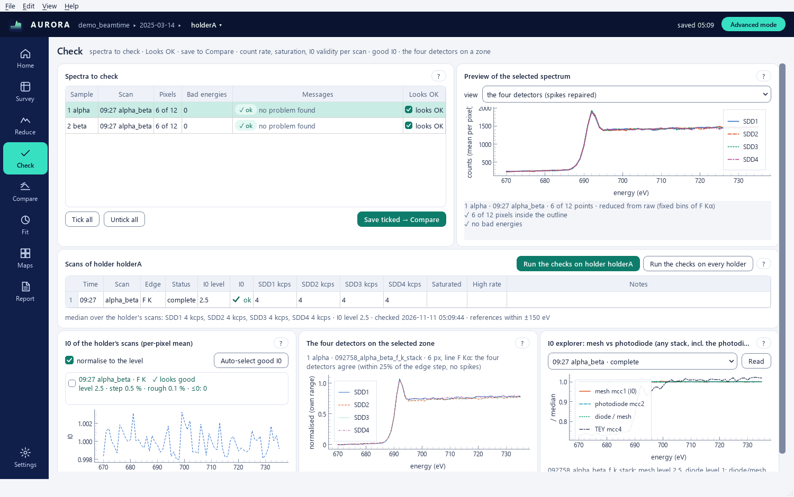

Check is John Bussey's *Check scans* step. In Easy mode it shows the spectra sent from Reduce with **Add to Check**,
with his sanity messages; in Advanced mode it adds the checks of every scan of the holder, the good-I0 picker, the
four detectors on a zone and the I0 explorer. On a short window in Advanced mode the page scrolls vertically.

### 5.1 Spectra to check

The card **Spectra to check** holds one row per sample region (zone) and scan:

| Column | Meaning |
|---|---|
| Sample | the zone drawn in Reduce |
| Scan | HH:MM and sample label of the scan |
| Zone pts | measurement points inside the region / points of the scan |
| Bad pts | energies flagged bad: spikes (interpolated), I0 below 20 % of its median, incomplete energies |
| Messages | chips *✓ ok*, *! check*, *✗ bad* (hover a chip for its messages), then the most important message |
| Looks OK | the spectrum is saved by **Save ticked → Compare** and goes into the report (it is the scan's *include* tick) |

The messages are the checks of John Bussey's GUI, ported: the region contains 0 measurement points (bad); only N
points, noisy (fewer than 3); a ticked SDD with no finite values or a signal zero everywhere (bad: check its window);
N missing energy points; I0 zero or missing at N energies; I0 varying by more than a factor 3 over the scan; TEY
without finite values; more than 10 % of the points flagged bad. AURORA adds the scan's flags with their source (SDD
saturated, high count rate, I0 invalid; from sgm_report or from AURORA's own check) and a note when spikes were found
within three energy steps of the edge. The thresholds (fewer than 3 points, a factor 3, more than 10 %) are those of
John Bussey's GUI.

A row with a bad message starts unticked. A row whose scan cannot be read shows *✗ bad* with the reason (and the error
is reported once). **Tick all** and **Untick all** change every row. Right-click a row for *Show the region in Reduce*
and *Remove from the queue*. A queued scan whose holder was never checked (no sgm_report summary, no earlier check)
gets the count-rate probe of its holder in the background, so the messages can name saturated SDDs and an invalid I0.

**view** (in **Preview of the selected spectrum**) chooses what the preview of the selected row shows (John Bussey's
five views): *detector signals, cleaned*; *fluorescence sum and its bad points* (crosses at the bad energies, as
measured); *I0 / max and TEY / max*; *sum / I0 and TEY / I0*; */ I0, min-max scaled*. The messages of the row are
listed under the plot.

**Save ticked → Compare** writes every ticked row without a bad message in John Bussey's file formats (5.3) to
`processed/reduced/<sample>/`, then adds those folders to Compare. Files that already exist are only overwritten after
a question (Yes overwrites, No skips those spectra). A row with a problem is reported as not saved. When one sample has
several ticked scans, the folder name adds the holder and the scan time (`<sample>_N5_0927`).
Labels that differ only in letter case (`1 alpha`, `1 ALPHA`) count as one sample, since Windows and macOS keep
them in one folder, and two zones of one scan with that name get `_2`, `_3`. The four files of a sample are
replaced together or not at all: one held by another program (Excel) leaves them as they were, the other samples
are saved, and one calm message names the file.

### 5.2 The holder checks (Advanced)

**Run the checks on holder N5** (named after the current holder; **Run the checks on this holder** in the empty panel
before the first check) sits in the header of **Scans of holder N5**, next to
**Run the checks on every holder**, which probes every stack of every holder in one job with progress and
**Cancel**. The probe reads seven energies of every stack (fast: the brightest pixels only) and fills the table:

| Column | Meaning |
|---|---|
| Time, Scan, Edge, Status | as in Home |
| I0 level, I0 | median mesh current and its verdict (ok / invalid) |
| SDD1 kcps … SDD4 kcps | count rate of the brightest pixels per detector |
| Saturated | the brightest pixels give the same total at every energy (CV < 2 %) while I0 varied (> 5 %), the rate is ≥ 2× the reference median and the output no longer follows the input (slope < 0.5): fluorescence unusable, TEY fine |
| High rate | ≥ 2× the reference median without the flat signature: dead time / pile-up likely |
| Notes | the reasons in words |

I0 is *invalid* when the mesh current is ≤ 0 or below 10 % of the other scans of the holder whose energy range
overlaps within ±150 eV (a Se L scan is not judged against the F K scans). The saturation rate reference is the same
energy-local set.

The results are kept in `.aurora/qc.json`: the table is filled again when the project opens, without probing. A scan
whose files changed since its check (newer or more energy folders) is checked again in the background. The line under
the table says when the checks ran and that the references are within ±150 eV. AURORA's verdicts act like the
sgm_report summary: new zones leave saturated SDDs out of the sum and use the good-I0 mean when I0 is invalid, also on
a beamtime without sgm_report.

**I0 of the holder's scans (per-pixel mean)** scores every scan's I0 curve: level, biggest step, roughness, number of
non-positive points. Tick the good ones, or **Auto-select good I0**; their mean is what scans set to *good-I0 mean*
in Reduce are divided by. **normalise to the level** overlays the curves on one scale.

**The four detectors on the selected zone** compares SDD1–4 on the zone chosen in Reduce and the scan selected in the
table, each with its pre-edge subtracted and scaled to its own range. A detector that differs by more than 25 % of the
edge step, or that carries isolated spikes, is named. The spike line counts the interpolated points per channel.

**I0 explorer: mesh vs photodiode (any stack, incl. the photodiode tests)** reads only the mcc CSVs of the stack
chosen in its list, including the photodiode tests that are hidden elsewhere (**Read**), and plots the mesh (mcc1,
I0), the photodiode (mcc2), their ratio diode / mesh and TEY (mcc4), each normalised to its median. The note gives the
mesh and diode levels and the span of the ratio over the scan. A ratio that drifts with energy means the mesh and the
diode disagree on the beam, which is what the photodiode test is there to decide. The curves are cached as JSON under
`.aurora/cache`.

### 5.3 John Bussey's file formats

For one zone and scan, Check's **Save ticked → Compare** writes into `processed/reduced/<sample>/`:

| File | Content |
|---|---|
| `<sample>_full_reduced.csv` | his header keys (sample_label, source_h5, survey_h5, scan_name, sdd_roi_channels, use_sdd_calibration, mcc_i0_channel, mcc_tey_channel, spatial_reduction, roi_points 'n / N', bad_point_reference, spike_z, processing) plus reduced_with (AURORA and its version), despike, detectors_in_total, zone, data_source and, when they apply, i0_source, i0_masked, incomplete, signal; columns energy, sdd1, sdd1_roi_lo, sdd1_roi_hi, … sdd4_roi_hi, I0, TEY, sdd_total, sdd_mean, bad_point |
| `<sample>_absorption.csv` | the same header; energy, sdd_total, TEY, I0, bad_point |
| `<sample>_polygon_roi.json` | the zone as his polygon: its one polygon, or the corners of its one rectangle widened by 0.45 pitch (AURORA's membership rule, so his strict test takes the same pixels) |
| `<sample>_zone.json` | instead of the polygon file when the zone is anything else; it says so in its `_comment` and holds AURORA's zone definition; an overwrite removes the other of the two files, so the folder describes one zone |
| `<sample>_gui_settings.json` | his keys (rois, params {i0, mode, tey}, stack_h5, survey_h5, spike_z, drop_energy_ranges, drop_indices) plus an `aurora` block (version, zone, settings, points, spikes, masked and incomplete energies) |

The numbers follow his reduction: per detector the mean over the zone pixels of the counts in channels [lo, hi) (his
'mean'; I0 = mcc ch1 and TEY = mcc ch4 over the same pixels). AURORA's processing is stated in the header: each trace
is interpolated at its own spikes (the zone's de-spike), energies with I0 below 20 % of its median keep their counts
but get an empty I0, and sdd_total / sdd_mean are over the ticked detectors, empty when one of them is missing at that
energy (his GUI summed the others). bad_point is True at every such energy. On his BO3 stack the written file equals
his `_full_reduced.csv` in every sdd1–4, I0 and TEY value (relative 1e-12). Compare reads the files as sdd-scaled,
sdd_total and TEY (each / I0). A zone using IPFY is written as counts too (the header says so): read back, sdd_total /
I0 is the PFY of that line.

## 6. Compare

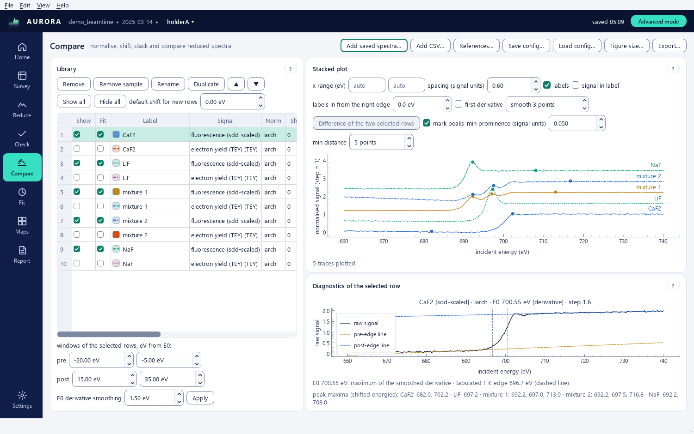

A **Library** of spectra, each row one trace, a **Stacked plot** and the **Diagnostics of the selected row**.

The library belongs to the project: it is saved in `<project>/.aurora/library.json` (rows, files, settings) and
`library_spectra.npz` (the traces without a file of their own: zone traces from Reduce, differences) a moment after
every change, and it comes back when the project is opened again. Easy mode is John Bussey's Compare tab: the columns
Show, Fit, Label, Signal, Shift eV and Colour, and rows that all come from saved John-format files, so every row is the
raw signal / I0 normalised with larch (two lines around E0, pre −20..−5 eV and post +15..+35 eV, flattened). These windows are AURORA's defaults, not John Bussey's (a line under the stacked plot says so in Easy mode): his GUI used pre −10..−5 and post +10..+34 eV, without the flattening step (his division by the post − pre line flattens the same way). On his BO3 file the two differ by up to 0.43 near the white line, and agree within 0.008 when given the same windows. Larch's own pre_edge also starts the post window 15 eV above E0 on these scans. As in his GUI, the TEY row of a John-format file starts with **Show** unticked.

### 6.1 Loading

- **Add saved spectra…**: a folder of reduced CSVs (one level of subfolders too). Easy mode takes John Bussey's
  `_full_reduced.csv` / `_absorption.csv` only (the files Check's **Save ticked → Compare** writes) and names the files
  it skipped; Advanced mode also reads AURORA zone CSVs and sgm_report `_xanes.csv`. Each file gives its signals
  (sdd-scaled sum, TEY, …) as separate rows.
- **Add CSV…** (Advanced): any column file; the energy column is found by name or taken as the first column.
- **References…** (Advanced): the reference-spectra library (6.5).
- From Reduce: **Send the zone's traces to Compare**; from Maps: the clusters' **Send to Compare**.
- **Save config…** / **Load config…** (Advanced): the whole library (files, shifts, normalisation, E0 choices,
  colours, ticks, the x range and spacing) as a JSON file. Paths are stored absolute and relative to the config, so a
  config moved together with its data still loads; the traces that have no file (zone traces, differences) are written
  next to it as `<name>_spectra.npz`. John Bussey's `compare_config.json` loads too (his keys `color` and `mcr` are
  read, and written as well). Loading replaces the rows.
- **Missing files.** When files of the library are not found (a folder was moved or renamed), their rows stay in the
  table without a spectrum and a message under the table names them. **Locate…** asks for the folder they are in now
  and finds every file by its name.

### 6.2 The table

| Column | Meaning |
|---|---|
| Show | plotted |
| Fit | the row is available in Fit |
| Label | editable; **Rename** and **Duplicate** act on the selected rows; ink text with a swatch of the trace's colour and dash |
| Signal | sdd-scaled, TEY, sdd1…, as read from the file (a list of the file's signals) |
| Norm | larch (two lines around E0), legacy (constant pre / post means over absolute windows), tey_line (pre-edge line only), none (a list) |
| Shift eV | added to the energy axis (calibration offsets) |
| Pre lo / hi, Post lo / hi | the fitting windows: eV from E0 for larch and tey_line; absolute eV for legacy, where a blank window reads *auto 15 %* / *auto 20 %* (the first 15 % and the last 20 % of the scan, John Bussey's defaults) |
| E0 | how E0 is found: `deriv` (the largest local maximum of the derivative smoothed over 1.5 eV, searched within 20 eV of the tabulated edge and never within 1.5 eV of the data or search-window ends), `half` (the first crossing of half the edge step, iterated twice), `table` (the tabulated edge from xraydb), `fixed` (the E0 eV value), `row:<label [signal]>` (the E0 of another row, so every row of a comparison shares one E0 and the edge shifts become the measured quantity) |
| E0 eV | the E0 in force; typing a value fixes it, an empty cell returns to `deriv` |
| Flatten | post-edge line flattened to 1 |
| Spacing, Scale | per-row offset (blank = the common spacing) and multiplier in the stacked plot and its figure only (John Bussey's *Scale (plot only)*): Fit, **Difference of the two selected rows** and the exported CSV use the trace unscaled |
| Diag | the row's raw signal and fitted lines are shown in the diagnostics panel |
| Colour | a button: click to choose the trace's colour; saved with the library and the config |

Each column has its own editor: a list for Norm, Signal and E0, a number box with its unit for the energies. A value
that cannot be used (a word in Shift eV, a window that ends before it starts) is put back, and the reason stays in the
message line under the table until **Dismiss** or the next message. **Remove**, **Remove sample** (all rows of the
file), **▲** **▼** reorder, **Show all** / **Hide all**, and in Advanced mode **default shift for new rows** (eV, John
Bussey's default energy shift). The windows row under the table (*windows of the selected rows, eV from E0*) writes
**pre**, **post** and **E0 derivative smoothing** into the selected rows (all rows when none is selected) with
**Apply**. In Advanced mode the table scrolls sideways and the Label column keeps a readable width; right-click the
header to show or hide columns.

**E0 and the tabulated edge.** The tabulated edge of a row comes from its file or folder name (`…_fluorine_k`,
`NaF_F_K.csv`), from the scan of a zone trace, else from the edge most stacks of the project were set up for. When E0
lies further from it than the width of the pre-edge window (15 eV by default), a calm note says so in the E0 eV
tooltip, the status line and the diagnostics: the E0-relative windows move with E0. A sharp pre-edge peak can catch
the derivative; `half` or `row:` avoid it. The smoothing width (1.5 eV, **E0 derivative smoothing**) and the search
window (20 eV either side of the tabulated edge, the start of the default pre-edge window) are AURORA defaults; the
smoothing keeps the scatter of E0 below 0.5 eV on a synthetic 1 eV wide edge with 2 % noise.

### 6.3 Stacked plot

**x range (eV)** (auto or fixed), **spacing (signal units)** (offset between traces, Advanced like the options
that follow), **labels** at the right end of every trace
(**labels in from the right edge**, Advanced, moves them inward by that many eV, John Bussey's label position; the
plot and the exported figure place them alike), **signal in label**, **first derivative** with a smoothing width,
**Difference of the two selected rows**. **mark peaks** finds local maxima with a **min prominence (signal units)**
and **min distance** and lists them (shifted energies) under the plot. The x range and the spacing, labels and label position
are kept with the library.

### 6.4 Diagnostics and export

The diagnostics panel shows the raw signal of the selected row with its pre-edge and post-edge lines, E0 (dotted) and
the tabulated edge (dashed); its title gives the normalisation, E0 and how it was found, and the edge step; the line
under it names the tabulated edge and any note.

**Figure size…** opens **Export figure: size and formats**, which sets the size of every exported Compare and Fit
figure (John Bussey's Plot size): **width** and **height** in inches (3.5 × 4.5 by default; presets **3.5 in (one
column)** and **7 in (two columns)**), **font size** (pt, 8 by default), **PNG resolution** (600 dpi by default: 2100 ×
2700 px at 3.5 × 4.5 in) and the **formats** **PNG**, **SVG** and **PDF** (all ticked). The figure is drawn again with
matplotlib at exactly that size, on white with the series colours and dashes, whatever the window looks like: the
shown traces with their offsets, the x range, the labels and axis titles with units. PDF text uses embedded TrueType
fonts and SVG text stays text, so both can be edited.

**Export…** writes a wide CSV (energy, every shown trace as processed, John Bussey's layout; with **first derivative**
ticked the derivative the figure shows, in `<label>-d/dE <signal>` columns), the figure in the chosen
formats, and the config JSON (with its `_spectra.npz` when some traces have no file).

### 6.5 Reference spectra

Settings holds a **reference spectra folder**. **References…** opens **Reference spectra**, which lists every csv /
txt / dat / nor / xmu file in that folder and one level of subfolders, with the edge guessed from the file or folder
name (`NaF_F_K.csv` → F K, `CaF2-fluorine-k.txt` → F K, `ref_Se_L3.csv` → Se L3) and a label cleaned of "ref" /
"edge" and underscores. Type an element in **element** to filter, tick the references, **OK**: they join the library
as ordinary rows, ready for Fit. The **folder** can be changed in the dialog (**Browse…**). The demo beamtime holds a
small synthetic reference folder, `references/`.

## 7. Fit

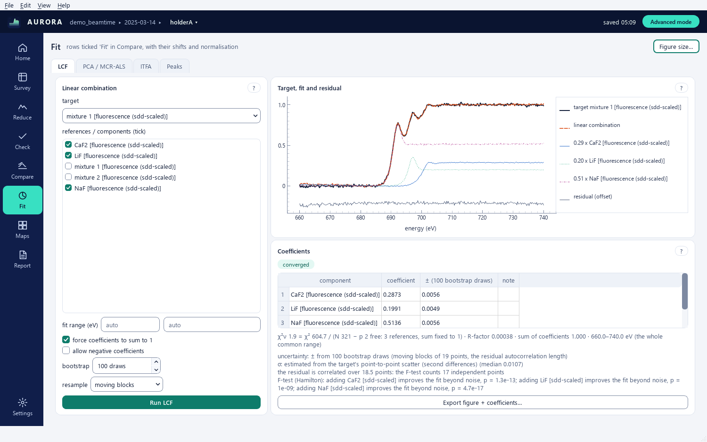

Fit works on the rows ticked Fit in Compare, with their shifts and normalisation applied. Four tabs: **LCF** (the only
one in Easy mode), **PCA / MCR-ALS**, **ITFA** and **Peaks**.

Every fit shows a chip with what it did: *converged*, *not converged:* with the reason, or *converged · N parameters
undetermined (σ > |value|)*. Rows at a bound or undetermined are tinted, and their tooltip says why. LCF, MCR-ALS and
ITFA run in the background with a progress strip and **Cancel**. **Figure size…** (top right) is the same setting as
in Compare (6.4).

### 7.1 LCF (linear combination fit)

The card **Linear combination**: **target**, the ticked **components (tick)**, **fit range (eV)**, **force coefficients to sum to
1** and **allow negative coefficients** (Advanced), **bootstrap** draws and **resample** (Advanced), **Run LCF**. When
the fit range boxes are blank, LCF uses the Compare x range (shown in the boxes as *670 (Compare)*), else the whole
common range. Easy mode states the options in force in a read-only line, for example *coefficients sum to 1 · no
negative coefficients · ± from 200 bootstrap draws · fit range: the Compare x range when the boxes are blank · John Bussey's GUI: sum free, negatives allowed, 685–705 eV*. These are AURORA's defaults: John Bussey's LCF tab left the sum free, allowed negative coefficients and fitted 685–705 eV.

The fit is weighted (1/σ²): σ is the spectrum's own uncertainty when it carries one, otherwise it is estimated from the
target's point-to-point scatter (second differences), and the result says which. Results (**Coefficients**): the
coefficients with ±, a **note** column (*at the 0 bound*, *undetermined*), χ²ν = χ² / (N − p) with N and p, the
R-factor (Σ residual² / Σ target²), the sum of the coefficients and the range used. Without a bootstrap (bootstrap =
0) the ± is the covariance error scaled by √χ²ν, the Larch / Athena convention. With a bootstrap (Easy: 200 draws,
*± from 200 bootstrap draws*) the ± is the scatter of refits on resampled residuals: resample *moving blocks* (the
default) resamples blocks as long as the residual's autocorrelation, so correlated residuals are not counted as
independent points; *single points (iid)* is the classic bootstrap, which understates the uncertainty on correlated
residuals (about 3.8 times on the test probe). In Advanced mode the detail lines give the uncertainty method, σ, the
residual correlation, and an F-test (Hamilton) per component: *adding X improves the fit beyond noise, p = 0.003*, or
*X does not improve the fit beyond noise*, with N reduced to the independent points when the residual is correlated.
Flags: a coefficient at the 0 bound, and, without sum to 1, a sum outside 1 ± 3σ. **Target, fit and residual** plots
them. **Export figure + coefficients…** writes the CSV (all of this in its header) and the figure in the Figure size
formats.

### 7.2 PCA / MCR-ALS

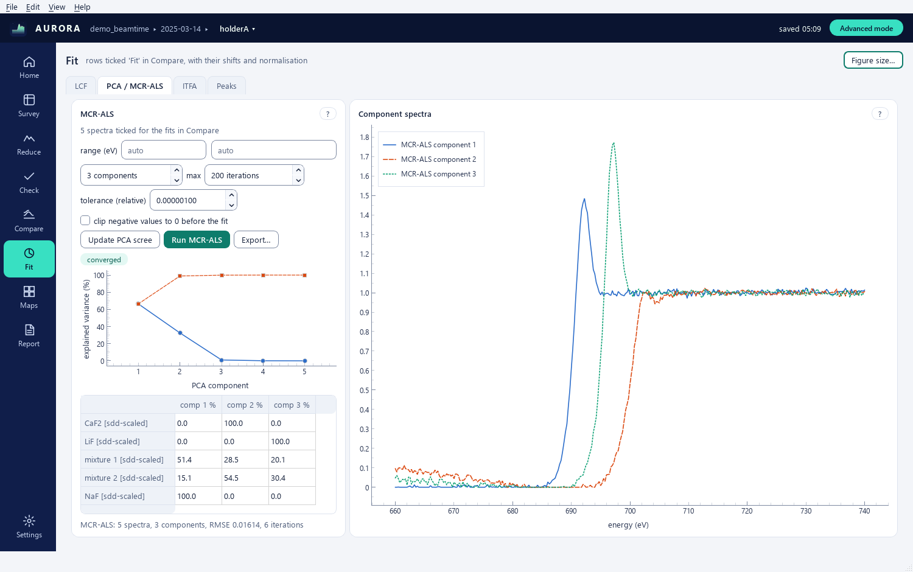

**Update PCA scree** shows the explained variance of the ticked rows over the **range (eV)**. Choose the number of
components, **max** iterations and the **tolerance (relative)** on the error change (the change of the RMSE between two iterations divided by the RMSE, so the scale of the data does not matter; John Bussey's GUI compared the absolute change with 1e-8), optionally **clip negative values
to 0 before the fit**, then **Run MCR-ALS**: alternating least squares with non-negativity on both spectra and
concentrations. The **Component spectra** and the per-sample proportions are plotted. MCR-ALS runs in the background
(**Cancel** stops it); its chip reads *not converged: max iterations reached (200) …* when the tolerance was not
reached. **Export…** writes the two CSVs and `MCR_component_spectra.png/.svg/.pdf`.

### 7.3 ITFA

Refines the MCR-ALS concentration profiles with some samples' component percentages held fixed (**ITFA: anchored
targets**: **sample** and **percentages (%, one per component)**, comma separated, then **Add target**; **Remove
target** drops the selected one), then **Run ITFA**. Use only with independent chemical evidence for the anchored
samples. ITFA works on the matrix of the last MCR-ALS run. When the rows ticked Fit, their normalisation or the range
changed since, it says *the spectra differ from the MCR run; rerun MCR first* and does nothing. **Export…** writes the
two CSVs and the figure of the **ITFA targeted component spectra**.

### 7.4 Peaks

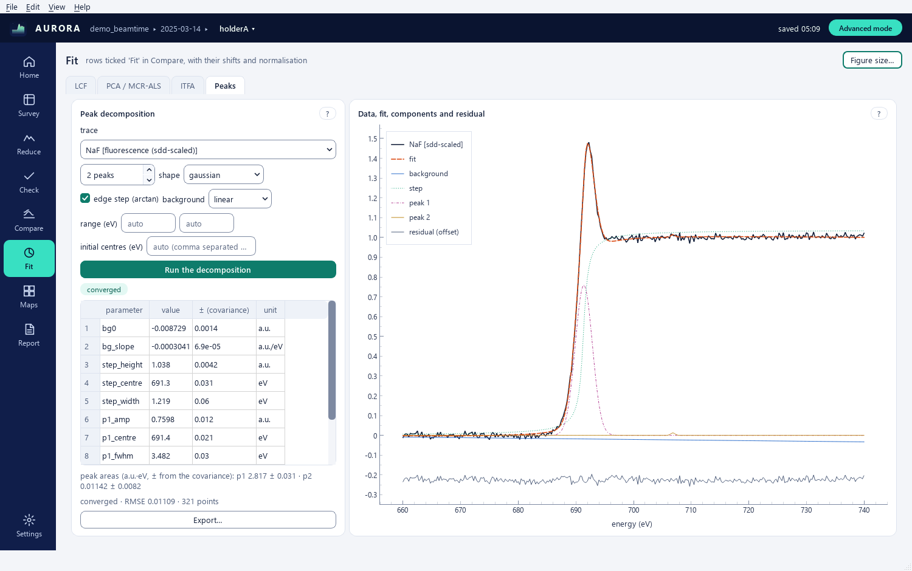

Decomposition of one trace into peaks on top of an edge (**Peak decomposition**): **trace**, number of peaks (1–8),
**shape** (gaussian, lorentzian, pseudo-voigt), **edge step (arctan)** (on by default), **background** (linear or
constant), **range (eV)**, **initial centres (eV)** (comma separated, or blank for automatic guesses from the local
maxima).

**Run the decomposition** fits peaks + arctan step + background with least squares. Every shape is set by its height,
centre and full width at half maximum (FWHM, eV); the pseudo-voigt also fits its Lorentzian fraction eta (0 to 1). The
step's width is its 25–75 % rise (the FWHM of its derivative). Typed initial centres come first; the remaining peaks
start at the most prominent maxima. The table lists every parameter (`p1_amp`, `p1_centre`, `p1_fwhm`, `p1_eta`, …,
`step_height`, `step_centre`, `step_width`, the background) with its ± (covariance) and its unit (eV for centres,
FWHM, the step centre and width; a.u. for amplitudes); the line under it gives the peak areas with errors propagated
from the covariance. A parameter the data cannot determine (σ > |value|, or a peak too small or too narrow to be seen,
whose σ is then infinite) or a centre at the edge of the range is tinted. A fit that did not converge is not drawn:
the data, the initial centres (dashed lines) and *fit not shown: not converged* (top right). **Data, fit, components
and residual** plots the result. **Export…** writes the parameters with units, the areas, the curves and the figure.

## 8. Maps

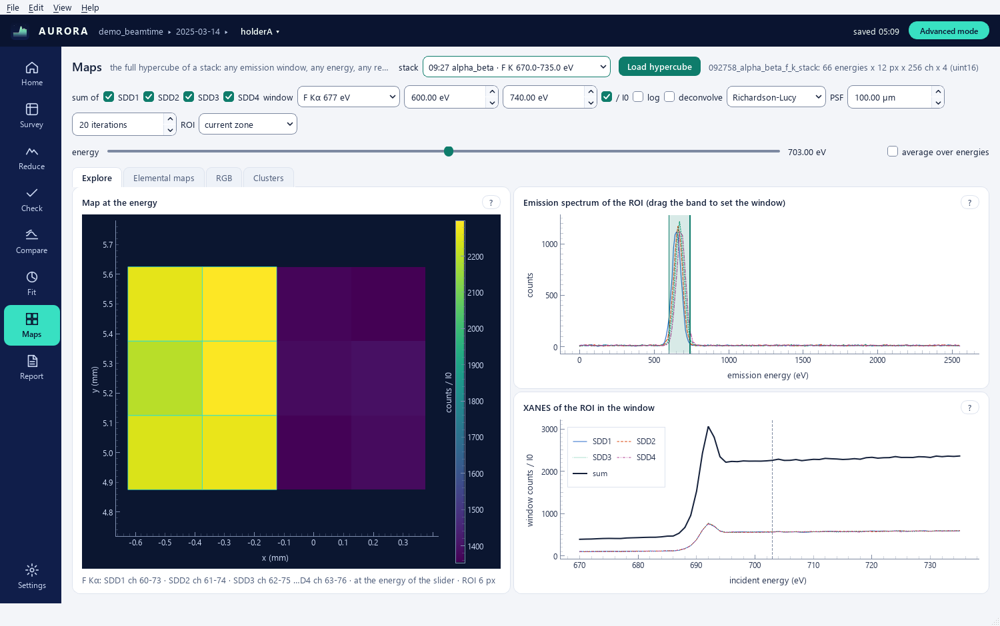

Maps is part of Advanced mode. The full hypercube of one stack: every channel of every detector at every energy.
Choose the **stack**; **Load hypercube** reads the raw `.bin` files once, one energy at a time, into a cache on disk
(8.5); a cancel keeps nothing. Before loading, the empty panel gives the size first (*up to 460 MB, cached under
.aurora/cache*, or *cached, opens at once*). A cube that finishes after another holder, stack or project was picked is
not shown (it stays cached, so **Load hypercube** opens it at once).

Every sum in Maps uses each detector's own channels for the emission window. The four SDDs have their own gain and
offset (`sdd_calibration.json`), so one eV window is a different channel range on each of them: on the 2026 beamtime
640–710 eV is channels 63–70 on SDD1, 68–75 on SDD2, 65–72 on SDD3 and 62–69 on SDD4. A fixed line uses each SDD's own
bins from `config/roi_bins.json`.
With **/ I0**, an energy whose I0 is below 20 % of its median (beam loss) is left out of the XANES, the clusters and
both exports, as in Reduce; the line under the map names it.

Top controls: **sum of** **SDD1** **SDD2** **SDD3** **SDD4** (the detectors in every sum: the map, the spectra, the
XANES sum, the elemental maps, the RGB composite, the clusters and the exports), **window** (a fixed line or *custom
(eV)* with the eV bounds), **/ I0**, **log**, **deconvolve** with its method (*Richardson-Lucy* or *Wiener*), **PSF**
(full width at half maximum of the beam in µm) and the iterations (Richardson-Lucy only), **ROI** (*whole map*,
*current zone*, *rectangle (draw)*), the **energy** slider or **average over energies**.

An SDD flagged saturated (by the sgm_report summary or by AURORA's own checks) starts unticked, and a note next to the
ticks says so, for example *SDD3 flagged saturated (sgm_report): not in the sum by default*. The scan is never dropped:
one tick brings the detector back.

Deconvolution sharpens a map blurred by a beam larger than the pixel pitch; it works on the gridded image, fills
pixels outside the measured points before and restores them after. Richardson-Lucy keeps counts non-negative and
needs 10–50 iterations; Wiener is a one-shot frequency filter with a constant noise-to-signal ratio. Treat the result
as a view, not as data: the exports are of the measured cube. A small map is deconvolved at once; a large one in the
background (progress and **Cancel** in the strip under the title, the line under the map reads *deconvolving …*).

### 8.1 Explore

**Map at the energy**: the map of the window at the chosen energy. **Emission spectrum of the ROI (drag the band to
set the window)**: one curve per ticked SDD, each on its own calibrated axis, with the window as a draggable band.
**XANES of the ROI in the window**: one curve per detector (an unticked one reads *not summed*) and the sum of the
ticked ones, with a dashed line at the energy of the map. The line under the map names the channels used on each
detector, for example *F Kα: SDD1 ch 60-73 · SDD2 ch 61-74 · …*.

Maps computes each part once: the map, the spectrum and the XANES are kept for their inputs, so going back to an
energy, a window or a ROI already seen is immediate. While the energy slider is dragged only the map follows; the
spectrum follows when the slider is released. When the XANES of the ROI has to read the cube (a custom window on a
zone or a rectangle), it is computed in the background and the plot reads *computing the XANES of the ROI …*. With
*current zone*, Maps follows zone edits while it is on screen; edits made elsewhere are applied once when Maps is shown
again.

### 8.2 Elemental maps

**Draw the elemental maps (every fixed line)**: one map per fixed line of `config/roi_bins.json`, summed over the
ticked SDDs, each with its own bins. The per-line sums are computed while the cube is read, so the maps never read the
cube again. **Export PyMca 4D (_Elemental_PyMca.h5)…** writes `_Elemental_PyMca.h5` in the background: every detector,
and the sums over the ticked SDDs (attribute `summed_sdds`).

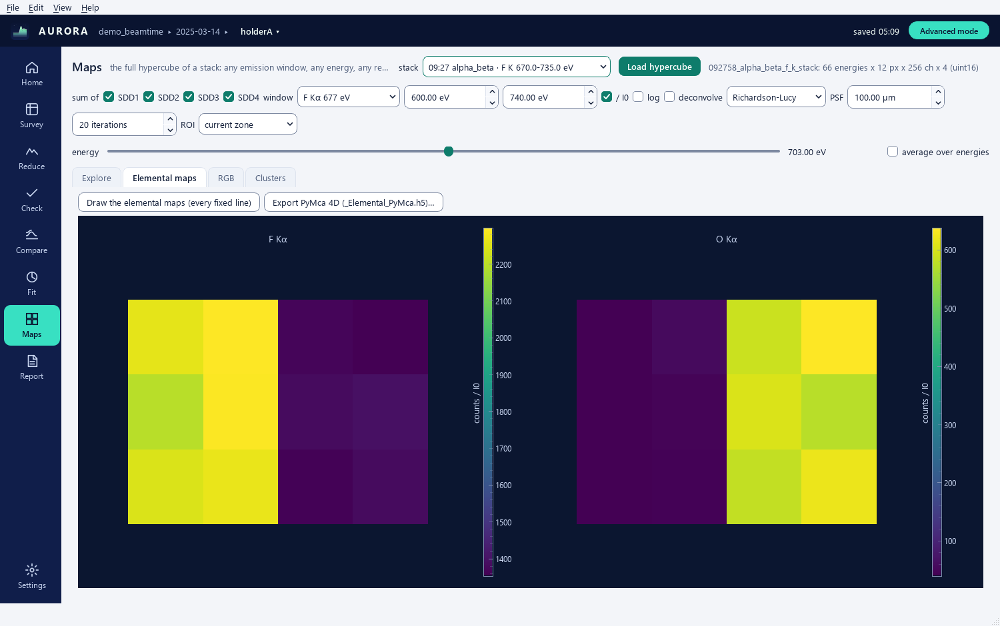

### 8.3 RGB

Three fixed lines (**R**, **G**, **B**) as a colour composite, summed over the ticked SDDs with each SDD's own bins;
**Draw the RGB composite**.

### 8.4 Clusters

**PCA + k-means on the pixels (window XANES / I0)**: PCA on the per-pixel XANES then k-means: **PCA** (components),
**k-means** (clusters), **seed (k-means)** (the same seed gives the same clusters again), **Run**. The clustering runs
in the background with progress and **Cancel**; a cancel keeps the previous cluster map. **Export PyMca XANES stack
(_PCA-CA.h5)…** writes `_PCA-CA.h5` (y, x, E): one dataset per ticked SDD, each with its own `channel_roi`, plus `sum`
and `average`.

**Clusters: tick to merge** lists every cluster with its colour and pixel count (*cluster 2 · 340 px*); the list is the
legend of the map and of the spectra. Each cluster has its own categorical colour (up to 20), and the line under the
map names the cluster under the mouse (*cluster 3 · 340 px · ticked*). Tick the clusters to
merge: the plot *cluster mean* shows the mean spectrum of every cluster and the merged mean of the ticked ones, the plot
*ticked sum* their summed spectrum; unticked clusters are dimmed on the map.

- **Make zone from ticked clusters**: a new zone of the holder made of the ticked clusters' pixels (one painted square
  of the pixel pitch on each pixel), named for example *clusters 1+3 · N5 09:27*. It works in Reduce, Check and the
  report like a drawn zone, and **Edit > Undo** removes it.
- **Send to Compare**: adds the merged mean of the ticked clusters to Compare (signal *fluo*), with its provenance:
  stack, windows per SDD, SDDs, PCA components, k, seed, clusters, pixel count.
- **Export…**: a CSV (energy, the mean of each cluster, the merged mean of the ticked ones, with a provenance header)
  and the cluster map as `<name>_map.png` next to it.

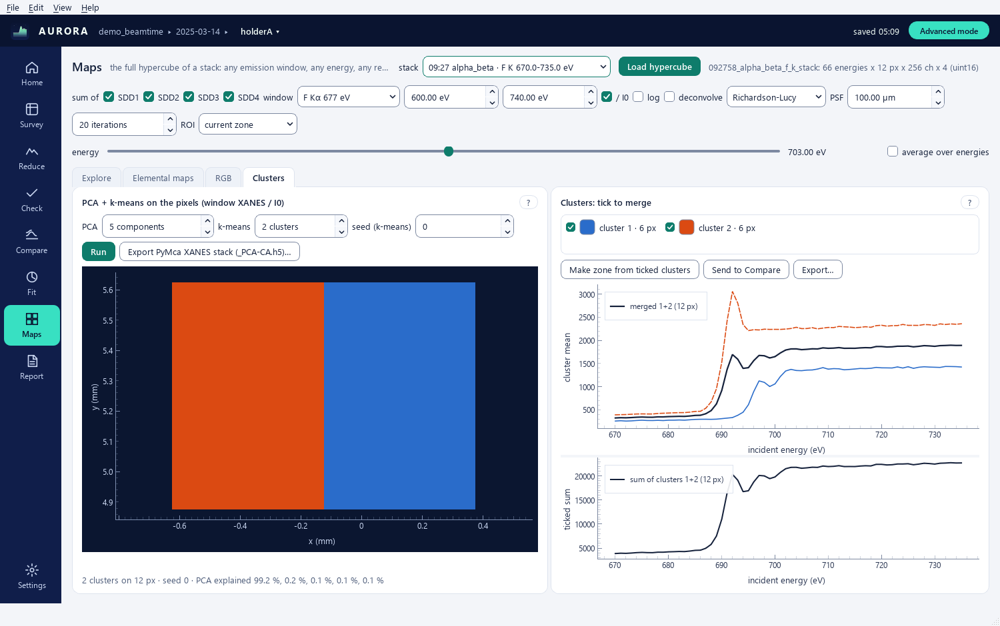

### 8.5 The hypercube cache

The cube is cached under `<project>/.aurora/cache/<day>/<scan>/hypercube-<key>/` as one memory-mapped file per
detector, in 16-bit integers when every count fits (about half the size of AURORA 0.3's cache), else 32-bit, with the
sums Maps needs (whole-map spectra, the energy total, one sum per fixed line). It is written in a temporary
`.building-<time>` folder and renamed in one step when complete, so a cancel or a crash never leaves a half-written
cube. Before writing, AURORA checks the free disk space and refuses calmly, for example *Not loaded: the hypercube
needs 4.1 GB in …, 2.0 GB free. Free some disk space, then load it again.* A project folder that cannot be
written (a read-only share) gets its cube in the per-user cache instead (INSTALL §5). A cache from AURORA 0.3 is
converted at the first load without reading the raw data again, then removed.

## 9. Report

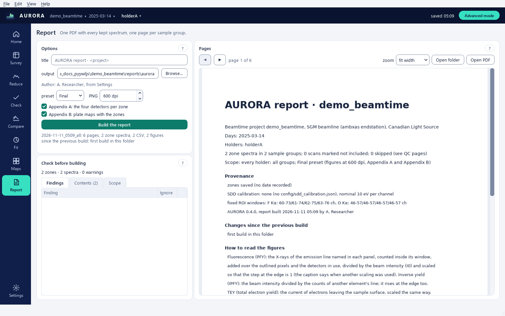

The final report, organised by sample group (in the order of the sample sheet; groups it does not name follow alphabetically, *Ungrouped* last), built from the zones and their settings. The Report perspective has
three cards: **Options**, **Check before building** and **Pages**.

### 9.1 Options

- **title** (default `AURORA report · <project>`), **output** folder (default `<project>/reports/aurora`,
  **Browse…**). Each build goes into its own folder inside it, so nothing earlier is overwritten (9.3). A folder that
  cannot be written (read-only, protected) gives one calm message that names it and points to **Browse…**.
- A muted line names the author: *Author: A. Name, from Settings* or *Author: A. Name, from the system account*, or *No
  author line (Settings > report author)*.
- Easy mode states what the report contains, read-only, for example *The report covers every holder and all groups,
  with Appendix A (the four detectors) and Appendix B (plate maps); Final preset, figures at 600 dpi.* A choice made in
  Advanced mode stays in force and is named there (*chosen in Advanced mode*).
- Advanced mode adds **preset** (*Final* or *Draft*), **PNG** (the figure resolution, in dpi), **Appendix A: the four
  detectors per zone** and **Appendix B: plate maps with the zones**.
  - *Final*: every holder, Appendix A and B, figures at 600 dpi.
  - *Draft*: the current holder only, no Appendix A or B, figures at 110 dpi. Appendix C (the quality notes) is always
    printed. After choosing a preset, the options can still be changed one by one.
- **Build the report** runs in the background with progress and **Cancel**. A build works on a snapshot of the zones,
  so editing zones during a build cannot change the report. When neither Settings nor the system account gives an
  author, the first build asks once (blank or Cancel builds without an author line; a name typed there is kept in
  Settings).

### 9.2 Check before building

**Check before building** runs by itself whenever the zones or the scope change while the Report perspective is shown.
Its first line counts what the next build contains, for example *14 zones · 31 spectra · 3 warnings* (ignored findings
are not counted). Three tabs:

- **Findings** (the number of open findings in the tab title). Each row has an icon, the Finding, an **Ignore** tick
  and a **Show** button that opens Reduce on that holder and zone (and selects the scan when the finding names one).
  Double-clicking a row does the same. An ignored finding is dimmed, sorted last, and remembered with the session
  (session.json `ui` block, key `preflight_ignored`). The check looks for:
  - zones without a group (they go under *Ungrouped*);
  - zones without an included scan (left out);
  - included scans on which the zone has no pixel, and scans not found in the project (left out);
  - zone labels not in the sample sheet, with the closest sample ID (a leading plate number such as `13 ` and the
    case, spaces and punctuation are ignored; a label that starts with the sample ID, for example `4 hematite
    (NH4)2SiF6` for `hematite`, counts as found);
  - the same label in one group on several holders;
  - complete stacks covered by no zone;
  - scans that cover a zone but have no settings for it yet (select the scan in Reduce to attach it);
  - zones that ask for the good-I0 mean on scans that no ticked good-I0 scan covers (their own I0 is used);
  - flagged saturated detectors still ticked (the flag names its source: sgm_report or AURORA check);
  - sample-sheet rows of a holder that have no zone.

  Coverage comes from the stage coordinates in each stack's .h5 file, so the check never reads the detector data.
- **Contents**: group ▸ holder (with its day) ▸ zone, with the Edge and the number of included Scans. A zone that will
  be left out carries a warning icon; its tooltip says why.
- **Scope** (Advanced): **Groups to include** with **All** / **None**, and **Holders (by day)** (tick a day for all
  its holders) with **Current holder** (only the holder shown in the top bar) and **All holders**.

### 9.3 What a build writes

**Pages**: the pages are previewed with **◀** **▶**; **Open folder** opens the folder of the last build, **Open PDF**
its PDF. The status line under **Build the report** names the build folder, the pages, spectra, CSVs and figures,
what changed since the previous build, and anything the build had to work around (a locked file).

Each build is written into `<output>/.building-<time>-<pid>-<token>/` and renamed, once complete, to
`<output>/<YYYY-mm-dd_HHMM>_<scope>/` (scope `all`, a holder list such as `N5` or `N5+N6`, days, groups, plus `_draft`
for a Draft). A second build in the same minute gets `_2`, `_3`, … A cancelled or failed build leaves nothing behind.
`<output>/latest.json` names the latest build and lists the last five; earlier build folders are never deleted.

| Item | Content |
|---|---|
| `<title>_<date>.pdf` | cover (project, days, holders, scope and preset, provenance, the author when there is one, *Changes since the previous build*, how to read the figures, contents, the full credits paragraph); one figure per group and edge (fluorescence above, TEY below, traces offset, labels at the right); Appendix A (four detectors per zone and scan); Appendix B (plate maps and zones); Appendix C (quality notes, scans covering a zone without settings, the other findings of the check with ignored ones marked, scans not included, anything skipped) |
| `figures/` | every group figure as PNG (600 dpi Final, 110 dpi Draft) and SVG |
| `csv/<group>/<holder>_z<zone id>_<label>_<scan>.csv` | one CSV per zone and scan, with its provenance header (9.4); a label or scan name longer than 40 characters is cut and followed by a short hash of the full text, so two labels that look alike never share a file |
| `csv/<group>/<same name>.json` | the JSON sidecar of each CSV: the header items plus the member pixel indices |
| `pages/` | PNG preview of every page |
| `report_manifest.json` | the build: options (preset, groups, holders, days, dpi, appendices), scope, author, every entry (holder, zone, scan, the full settings, the member pixels, the flags with their source, the good-I0 scans, the data source, the CSV path and its sha256), the zones, settings and scans in scope (for the next build's comparison), `changes_since`, the check's findings (`preflight`, with `ignored`), `scans_without_settings`, the totals line, notes |

Every page carries a two-line footer: *AURORA x.y.z · AURORA, version 2 of John Bussey's SGM XAS GUI, based on James
J. Dynes' SGM notebooks*, then the project, the author (when there is one) and the date. The PDF metadata carries the
title, Creator (AURORA and its version), Subject (the credits line) and Author (when there is one).

If a file cannot be written because another program holds it, AURORA writes `<name>_2.<ext>` and says so in the status
line and the manifest notes. The same report runs headless (section 11).

### 9.4 Provenance of the CSVs

Every report CSV starts with `# AURORA x.y.z (version 2 of John Bussey's SGM XAS GUI)`, followed by one `# key: value`
line per item: zone (label, id, holder, day, group, comment), scan, edge, line, signal (PFY or IPFY), `data_source`
(`sgm_report cache` or `raw reduce`) and its file, `sdd_roi_channels` (the emission window per SDD, `[first channel,
last channel + 1)`) and where it comes from (`config/roi_bins.json`, the total XRF window, or the zone's own
per-detector windows), the detectors in the sum, the normalisations, the pre- and post-edge windows, the I0 source and
the good-I0 scans averaged, de-spike, `spikes_eV`, `skipped_energies_eV`, `masked_energies_eV`, notes,
`zone_geometry`, `members` (pixel count), the flags with their source, the SDD calibration, the full `settings` (as
stored in session.json) and `columns`. Lists and dicts are JSON; text is plain. The header alone is enough to
recompute the numbers: the values are written with 15 significant digits.

A past build can be verified from Python: `ReportBuilder(project, zones, out).verify(<build folder or
report_manifest.json>)` (aurora.core.report) rebuilds every CSV of that build from the current project and zones in a
temporary folder and compares the checksums; it names each entry whose CSV differs (with the settings that changed),
each entry no longer built and each new one.

## 10. Settings

The Settings dialog (**Settings** on the rail, or **File > Settings…**) holds the few defaults that are not per scan.
Its **Help** button opens this section. Easy mode shows the first six rows; Advanced mode adds the others.

| Setting | Effect |
|---|---|
| appearance | follow the system, light or dark; applied at once (also **View > Appearance**) |
| text size | normal, large or larger (13, 15 or 17 px); applied at once (also **View > Text size**) |
| report author | printed in the page footers and the PDF metadata. Blank by default: AURORA then uses the full name of the system account (Windows display name, macOS / Linux account name); when the system has none, the first report build asks once (blank or Cancel builds without an author line, a name typed there is kept here) |
| open the last project at start | on by default; an unreachable last project gives a calm note on Home and never blocks the start |
| advanced mode | every option (Advanced) or the basic path of John Bussey's GUI (Easy, the default); also **View > Advanced mode**, the top-bar button and **Ctrl+Shift+A** |
| check GitHub for a newer AURORA at start (once a day) | off by default; when on, AURORA asks GitHub at most once a day and shows a notice when a newer release exists (nothing is downloaded); **Help > Check for updates…** asks at any time |
| de-spike threshold k (Advanced) | default for new zone settings, in MADs (6) |
| default fluorescence normalisation, default TEY normalisation (Advanced) | defaults for new zone settings (/ I0, edge jump = 1) |
| map colour map (Advanced) | viridis, magma, inferno, plasma, cividis; applied to every map when Settings is accepted (clusters and RGB keep their own colours) |
| reference spectra folder (Advanced) | the folder behind **Compare > References…** |

Per-scan choices (detectors, lines, normalisation, I0 source) live with each zone in the session file, not here.
Settings are stored per user: in the registry on Windows, in the preferences on macOS, in `~/.config` on Linux (INSTALL
§5 gives the exact places); the environment variable `AURORA_SETTINGS_DIR` redirects them to `aurora.ini` in that
folder (used by the tests and the self-test). The same store keeps the recent projects, the last folder of each file
dialog, the figure options of 6.4 and the time of the last update check.

## 11. Command line

```
aurora                          the application (opens the last project when enabled in Settings)
aurora <project folder>         the application on that project (also: aurora <file>.h5, aurora gui <project>)
aurora project <project>        list days, holders, scans, status and flags (no Qt)
aurora scan <scan folder>       one scan's metadata and first energy (no Qt; also a scan's .h5 file)
aurora report <project> [--zones zones_all.json] [--out folder] [--title T] [--groups A B]
                                [--holders N5 N6] [--days 2026-11-05] [--preset final|draft]
                                [--author NAME] [--no-appendix] [--no-maps] [--dpi 600]
aurora demo <folder>            a small synthetic beamtime for the tutorials (a new or empty folder only)
aurora --selftest [--out report.json] [--platform offscreen|native] [--keep] [--no-gui]
aurora --distcheck              fast offscreen smoke test of an installation
aurora --version
```

`aurora report` without `--zones` uses `<project>/.aurora/session.json`, so a report built from the session the GUI
saved is identical to the one the Report perspective builds. It writes into `<out>/<YYYY-mm-dd_HHMM>_<scope>/` like the
GUI and prints that folder. `--preset` sets the defaults of `--dpi`, `--no-appendix` and `--no-maps` (a Draft gets 110
dpi without Appendix A or B; explicit flags win). `--holders` (names or keys) and `--days` narrow the scope; a scope
that matches nothing names the project's holders and returns 1. The author comes from `--author` when given (`''`
prints no author line), else Settings > report author, else the system account's full name.

`aurora --selftest` checks every core path and every perspective on a synthetic beamtime in a temporary folder and
writes a JSON report (`--out`); the exit code is the number of failed checks (0 = all passed). **Help > Run
self-test…** runs the same command.

`aurora project <folder>` on a loose folder prints real days (the date of each scan's file).

From an installed copy, replace `aurora` by `aurora-cli.exe` on Windows (the console twin of `AURORA.exe`, in the same
folder) or by `AURORA.app/Contents/MacOS/AURORA` on macOS. Every command writes to the log file (INSTALL §5); a failing
command returns exit code 1 and logs its traceback. A wrong path or file (no beamtime, no scan folder, no zones yet,
a malformed zones file) prints one line that says so and where the log is; any other failure also prints its
traceback. Output is UTF-8 in any console or pipe.

## 12. Files AURORA reads and writes

Reads (never modified):

| Path | Content |
|---|---|
| `raw/<day>/<HHMMSS>_<name>_<plan>/` | `.h5` (hexapod waves, stack and scan metadata); per-energy folders `…_<EEE>_<ff>eV/` with `mcc_flyer_0.csv` (ch1 mesh I0, ch2 photodiode, ch4 TEY) and `sdd1..4_0.bin` (uint32, n_pix × 256) |
| a loose folder of scan folders (`CLS GUI/<scan folders>`) | the same scan folders without `raw/<day>/`; the day of each scan comes from its `.h5` file |
| `processed/<day>/<scan>/_reduced_cache.npz`, `_count_rate.json`, `summary.json` | sgm_report v2.5 caches; used when present so that the numbers equal the beamtime report |
| `processed/reduced/<sample>/*_full_reduced.csv`, `*_absorption.csv` | John Bussey-format spectra, read by Compare |
| `config/roi_bins.json` | fixed emission windows per line and detector |
| `config/sdd_calibration.json` (or the sibling `SGM_Beamline_Analysis-main/`) | channel → eV per detector |
| `config/plate_layout.json` | holder → groups with rows, cols, cells of plate numbers (top row first) and match words; `samples` maps plate numbers to names; read by Survey > **Grid of zones…** |
| the sample sheet (first parsable cp1252 CSV at the project root) | zone labels and groups |
| `zones_html/sketches/<holder>.png` | holder sketches |

Writes:

| Path | Content |
|---|---|
| `<project>/.aurora/session.json` | the session: a header `{"format": "aurora-session", "schema": 2, "app": "AURORA <version>"}`, then the zone tool's keys (holders, zones with id, label, group, comment, rects, erects, paint, erase, polys, per-scan settings `st` and `members`, goodI0) plus the `ui` (view memory, including `preflight_ignored`) and `rules` blocks; per-scan settings may carry `roi` (XRF windows), `sig`, `dsm` and `pin` (fields set by hand); keys AURORA does not know are kept. Written atomically (a temporary file, then a replace) |
| `<project>/.aurora/session.json.bak` | the previous good session.json, replaced at every save |
| `<project>/.aurora/backups/session-YYYYmmdd-HHMMSS.json` | snapshots: at most one per 10 min of editing, plus one before every import, proposal, rule application and restore; the last 30 are kept; each carries a `backup` note (reason, time) |
| `<project>/.aurora/session.corrupt-<time>.json` | a session.json that could not be read, set aside once and never overwritten |
| `<project>/.aurora/session.lock` | the AURORA that has the project open for editing (process, computer, user, start and last-seen time, refreshed every 2 min); removed when it closes; another AURORA opens the project read-only; taken over when its AURORA has ended or has not been heard from for 10 min |
| `<project>/.aurora/session.v1.bak.json` | the original of a session written by AURORA 0.3 or earlier (schema 1), kept once before the first save in the new schema |
| `<project>/.aurora/qc.json` | AURORA's checks per scan (I0 level and verdict, kcps per SDD, saturated and high-rate SDDs, notes, when and with which version, the scan's file time for the re-check); written atomically; delete to check again |
| `<project>/.aurora/library.json`, `library_spectra.npz` | the Compare library of the project (rows, files with absolute and relative paths, E0 choices, colours, the x range and spacing) and the arrays of traces without a file; written atomically a moment after each change, never when nothing changed |
| `<project>/.aurora/library.corrupt-<time>.json`, `library_spectra.corrupt-<time>.npz` | a library.json that could not be read, and its arrays, set aside (the library then starts empty and a message says so) |
| `<project>/.aurora/cache/<day>/<scan>/` | reduced stack `_reduced_cache.npz` (numbers and text only, signed with the XRF windows, the energy count and the newest energy-folder time; rebuilt by itself when `config/roi_bins.json` or the energy folders change), `_mcc_curves.json`, `_emission_cache.npz` (per-pixel emission spectra), `_xrf_windows/w<lo>-<hi>_….npz` (counts in custom XRF windows), and the hypercube in `hypercube-<key>/` (`cube_sdd1.npy` … `cube_sdd4.npy` uint16 or uint32, `xrf_total.npy`, `bins_<hash>.npy`, `cube_aux.npz`, `cube_meta.json`); delete at will |
| `<project>/processed/reduced/<sample>/` | John Bussey-format files written by Check's **Save ticked → Compare** (5.3) |
| report output folder | one folder per build, `<YYYY-mm-dd_HHMM>_<scope>/`, plus `latest.json` (section 9) |
| exports | Compare (wide CSV, figure PNG / SVG / PDF, config JSON and `<name>_spectra.npz`), Fit (CSV, figure PNG / SVG / PDF; MCR and ITFA: two CSVs and the component figure), Maps (PyMca h5, cluster CSV and map PNG), zones (`zones_all.json`) |
| `_PCA-CA.h5` (Maps export) | (y, x, E) stack per ticked SDD with its own `channel_roi` attribute [lo, hi) per dataset, `channel_roi_sddN` and `sdds` on the group, `sum` and `average` |
| per-user folders | settings, the log files, matplotlib's font cache for the report figures (installed copies only), the self-test reports, the demo beamtime of **Help > Open the demo beamtime**, and the hypercubes of projects whose folder cannot be written (INSTALL §5) |

A loose folder of scans is its own project: `<loose folder>/.aurora/session.json` and `.aurora/cache/<day>/<scan>/`
are written inside it, nothing next to it.

**Export zones…** writes the zone tool's zones_all.json: version 1, without the header and the `ui` and `rules`
blocks. A session.json with a higher schema than this AURORA knows opens read-only.

A cache that cannot be read (a copy cut short, a full disk) is renamed `_reduced_cache.npz.bad` and the stack is
reduced again from `raw/`; the stack's first note says so. The `.bad` file is never read again and can be deleted. An
sgm_report cache in `processed/` whose windows differ from `config/roi_bins.json` is still used, since it is the
beamtime's own reduction, and the Reduce map line names its source *sgm_report cache with other windows*; **File >
Re-reduce the stack with the project ROI bins** (Advanced) reduces that stack from `raw/` with the project's windows.

## 13. Troubleshooting

- **Plots are empty, maps are blank**: PySide6 older than 6.10 paints no pyqtgraph items. The installers ship a
  recent version; from source, install in a fresh environment (`INSTALL.md`).
- **A scan is listed as test**: its span is under 5 eV or its name contains photodiode / dark / test. It is still
  readable in the I0 explorer and with `aurora scan`.
- **A scan is aborted but the beamline is still writing it**: the 25 min rule; **Reload** later.
- **The zone has no settings card**: cards appear for loaded scans only, in Advanced mode. The zone is already
  attached to every complete stack it covers (the status line and the zone list say how many); pick a scan in the
  list to see and edit its card.
- **The report left a zone out**: the Report perspective's **Check before building** list and the zone's tooltip in
  **Contents** say why before you build; Appendix C repeats it in the PDF.
- **Numbers differ from the beamtime report**: AURORA uses the sgm_report caches when they exist; after deleting
  `processed/`, the raw reduce gives the same spectra within floating point but the I0 flags come from AURORA's own
  Check instead of the summary.
- **Check names a saturated SDD that sgm_report did not**: AURORA's own check (qc.json) is a second source; both are
  quoted with their source.
- **A white line disappeared on a coarse scan**: files from earlier versions use the classic de-spike, which takes
  one-point features for spikes; new scans use the coherent rule. The traces' notes list every interpolated point in
  eV.
- **The map line says 'sgm_report cache with other windows'**: `config/roi_bins.json` was edited after sgm_report
  reduced this stack. The spectra still use sgm_report's windows; **File > Re-reduce the stack with the project ROI
  bins** (Advanced mode) reduces it with the project's windows.
- **A `_reduced_cache.npz.bad` file appeared**: the cache was damaged and was set aside; the stack was reduced again
  from `raw/`. The file can be deleted.
- **session.json was damaged**: AURORA set it aside as `session.corrupt-<time>.json` and restored the zones from
  the newest readable state in `session.json.bak` and `.aurora/backups/`; **File > Restore zones from a backup…** (Advanced
  mode) offers older ones.
- **The top bar says read-only**: the session.json was written by a newer AURORA, the project is open in another AURORA (the message names it), or its folder cannot be written. Edits are shown but not saved;
  closing the window offers **Export zones…** (Survey > **Export zones…** in Advanced mode), or open the project with the newer AURORA, or close the other AURORA and **Reload**.
- **The Compare library came back empty**: its library.json could not be read; it was kept as `library.corrupt-<time>.json`.
- **Undid too much**: **Ctrl+Y** (or **Ctrl+Shift+Z**) redoes; **Edit > History…** (Advanced mode) jumps to any
  point.
- **A control described here is missing**: it is probably an Advanced control; switch with **Ctrl+Shift+A**.
- **A command prints nothing on Windows**: `AURORA.exe` is the windowed application; use `aurora-cli.exe` in the same
  folder for the command line (INSTALL §4).
- **Something fails on another computer**: run **Help > Run self-test…** there and send the JSON report with the text
  of **Help > Report a problem… > Copy diagnostics**. GitHub issues are public: both name folders, and the log lines name projects, scans and samples, so read them before posting.
- **Settings look wrong in a test**: set `AURORA_SETTINGS_DIR` so that tests never touch the real settings.
