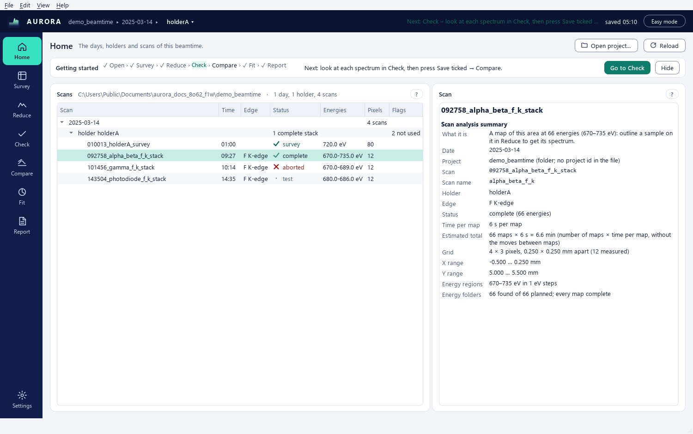
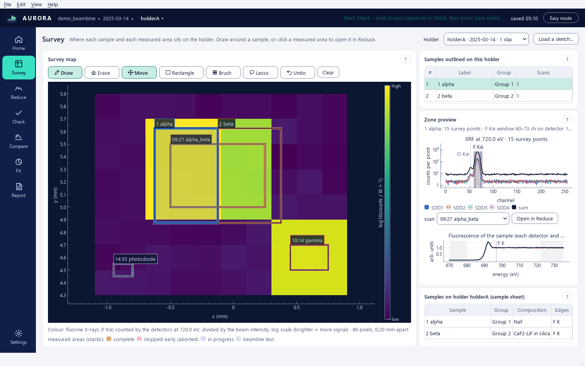
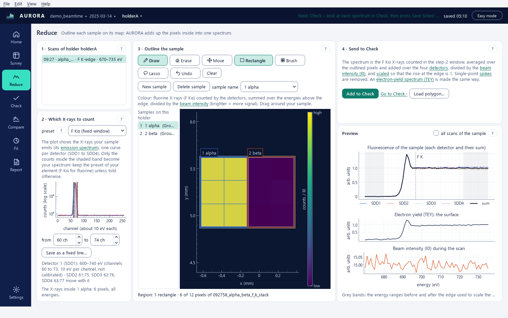
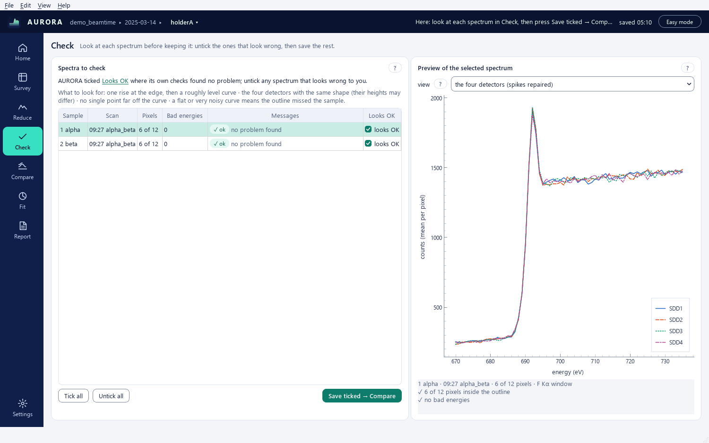
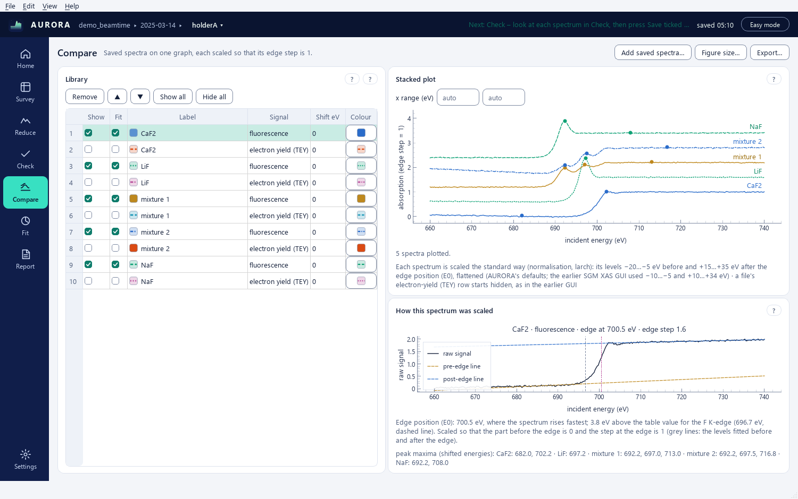
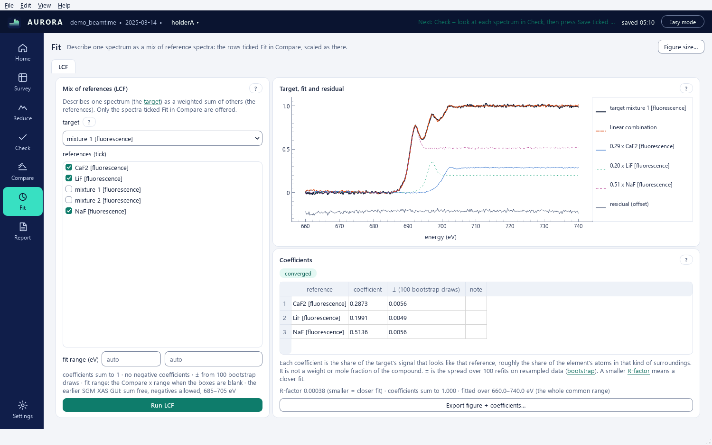
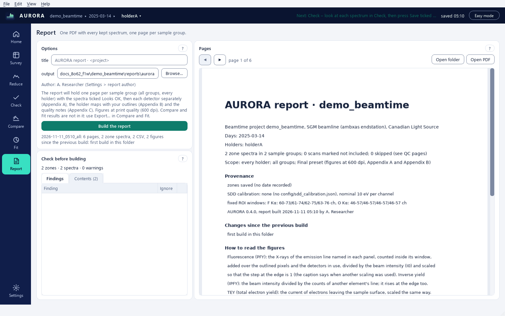

# AURORA user guide

AURORA turns the maps recorded at the SGM beamline (ambxas endstation, Canadian Light Source) into one X-ray
absorption spectrum per sample, checked and collected in a report, with comparisons, fits and maps for those who need
them. New to X-ray absorption? Start with the quick start below and **Help > Glossary**. AURORA is version 2 of
John Bussey's SGM XAS GUI, based on James J. Dynes' SGM_Beamline_Analysis notebooks. Nothing is ever written into
`raw/`.

This is the short guide. `MANUAL.md` describes every control, `TUTORIALS.md` walks through the demo beamtime
(**Help > Open the demo beamtime**, or `aurora demo <folder>`), `INSTALL.md` covers the installers (Windows 10 or 11;
macOS 15 or later, Apple silicon or Intel) and where things are stored. All four open from the **Help** menu; **F1**
opens the page's section of this guide's quick start in Easy mode (the manual's section in Advanced mode), and the
small **?** of every panel the manual at that panel's section.
**Help > Keyboard shortcuts** (**Ctrl+/**) lists every shortcut.

**Easy and Advanced mode.** AURORA starts in **Easy mode**, the main steps with standard settings: open the
beamtime, outline the samples in Reduce, check the spectra, compare them, fit them with LCF, build the report. Easy mode
shows the controls of that path, in plain words, and states the values it uses. **Advanced mode** shows every option, and the Maps
perspective; switch with **View > Advanced mode**, the mode button at the right of the top bar (it reads **Easy mode**
or **Advanced mode**), or **Ctrl+Shift+A**. Switching never changes a value, and the mode chosen is kept for the next
start.

The top bar shows *project ▸ day ▸ holder ▾*: click the holder to switch, or use **Ctrl+PgUp** / **Ctrl+PgDown**;
**Ctrl+1** … **Ctrl+8** open the perspectives. Next to it, the save indicator reads *unsaved*, then *saved* with the
time: the session saves itself within a second of every change. **Ctrl+Z** undoes the last zone or settings change
(**Edit > Undo** names it), **Ctrl+Y** redoes it. **View > Appearance** and **View > Text size** choose light or dark
and a larger text, at once. Long tasks run in the background with a progress strip and **Cancel** (**Esc**).

## Quick start for non-specialists

**What the beamline measured, in five lines.**

1. X-rays of one energy hit the sample. When the energy passes an *absorption edge* of an element (fluorine: near
   697 eV), that element starts to absorb.
2. Each absorption makes the sample give off X-rays of its own (*fluorescence*) and electrons (*electron yield*, TEY).
   Four detectors count the X-rays, and a gold mesh measures the beam itself (*I0*).
3. The beamline maps a holder of samples pixel by pixel: first a *survey* at one energy, to find the samples, then
   *stacks*, the same small area mapped at many energies across the edge.
4. Every pixel of a stack therefore holds an X-ray absorption spectrum (XAS): signal ÷ beam, energy by energy. Its
   shape near the edge tells the chemical state and the neighbours of the element.
5. AURORA adds up the pixels of each sample you outline into one spectrum, checks it, and builds a report.

**Your first spectrum.** Easy mode, about ten minutes on the demo:

1. **Home**: click **Open the demo beamtime** (or **Open project…** and the folder that contains `raw`). The
   *Getting started* row at the top of Home, and the *Next* link of the top bar, say what to do next at every step.
2. **Survey**: the map of the holder. The rectangles are the measured areas (stacks); click one to open it.
3. **Reduce**: step **2 · Which X-rays to count** is preset for your element: keep it. In step **3 · Outline the
   sample**, drag around your sample on the map; it takes its name from the sample sheet when the stack's name holds
   it, otherwise pick or type its name in **sample name** (or in the field *Name this sample:* that **Add to Check**
   opens). Step **4 · Send to Check** says
   in one sentence how the spectrum is made; press **Add to Check**.
4. **Check**: look at the preview. A good spectrum rises once at the edge, then stays roughly level, and its four
   detector curves have the same shape. Untick **Looks OK** on any that does not, then press **Save ticked →
   Compare**.
5. **Compare**: your saved spectra on one graph, each scaled so that its edge step is 1. **Fit** (optional) describes
   one spectrum as a mix of reference spectra.
6. **Report**: **Build the report** writes a PDF with one page per sample group, in a new folder each time.

**Words.** **Help > Glossary** explains every term. The tooltip of a control that uses one ends with *What is …?*, and
underlined words in the captions open the glossary at that word.

**When something looks wrong.**

| What you see | What it means | What to do |
|---|---|---|
| a flat or very noisy spectrum | the outline missed the sample, or holds very few pixels | draw the outline again over a bright part of the map |
| a curve drawn dashed in Compare, *not scaled* | its energies do not reach far enough before or after the edge | nothing to fix in AURORA: the scan did not cover the edge; it is shown scaled 0 to 1 |
| *inverse yield (IPFY)* in Check, and detector curves that dip | the window counts another element's X-rays; the spectrum is computed as beam ÷ counts and rises at the edge | normal; choose the line of the edge element in step 2 to count its own X-rays |
| detector curves of different heights | the four detectors see the sample from different angles | normal when their shapes agree |
| *saturated* detectors, or *no detector left in the sum* | too many X-rays for those detectors | use the electron-yield (TEY) spectrum of that scan |
| *read-only* in the top bar, a banner about a read-only folder | AURORA cannot write in the beamtime folder | press **Choose a working folder…** in the banner: your work is kept in a folder of your own, the beamtime folder is only read |

### Home in Easy mode



**Open project…** opens the beamtime folder (the one that holds `raw/`; a day folder, a scan folder or a loose folder
of scans opens too). The tree lists the days, the holders and their scans; a click on a scan shows what it is. The
*Getting started* row at the top names the next step and its button; **Hide** puts it away.

### Survey in Easy mode



The map of one holder at one energy, brighter where more X-rays came back (the colour scale reads *low* to *high*).
The rectangles are the measured areas (stacks). Choose **Draw**, then drag around a sample: the *Zone preview* shows
its X-rays and its spectrum while you drag. **Erase** takes part of an outline away; in **Move**, a click on a
rectangle opens that stack in Reduce. A hand-drawn sketch of the holder is optional: **Load a sketch…** adds one.

### Reduce in Easy mode



Four numbered steps: the scans of the holder; which X-rays to count (keep the preset of your element); the sample's
outline on the stack map (**Draw** / **Erase** as on the Survey, and its **sample name**); then **Add to Check**,
with one sentence saying how the spectrum is made. The *Preview* on the right shows the spectrum as it will be saved.

### Check in Easy mode



One row per sample and scan. A good spectrum rises once at the edge and then stays roughly level, and its four
detector curves have the same shape. Untick **Looks OK** where it does not, then **Save ticked → Compare**.

### Compare in Easy mode



The saved spectra on one graph, each scaled so that its rise at the edge is 1; a spectrum that cannot be scaled that
way is drawn dashed with the reason. **Add saved spectra…** brings in spectra saved earlier.

### Fit in Easy mode



Describes one spectrum as a mix of reference spectra (LCF): tick the references, press **Run LCF**; each coefficient
is the share of that reference, and the R-factor says how close the mix comes.

### Report in Easy mode



**Build the report** writes a PDF with one page per sample group, its figures and CSV files, into a new dated folder
each time; the *Check before building* list names what to look at first.

## 1. Open a beamtime

New to AURORA? The quick start above walks through every step on the demo. **File > Open project…**, or drop the
folder that contains `raw/` (the folder you downloaded from the beamline) on the window. A single
day folder or a scan folder works too (that day alone: **Show every day** opens the rest), and so does one scan's
`.h5` file dropped on the window. AURORA also opens the folder John Bussey's GUI used,
where the scan folders sit side by side (`CLS GUI/`): choose that folder with **Open project…**. Its zones are saved
inside it, in `.aurora/`.

Before a project is open, Home offers **Open project…**, **Open the demo beamtime**, **Read the tutorials** and the
**Recent projects**; a greyed one is not reachable now (a network share that is not mounted). AURORA lists the days,
the holders (a survey starts a holder, and a stack recorded after midnight stays with its holder) and the scans with
their status:

| Status | Meaning |
|---|---|
| complete | every planned energy folder is there |
| in progress | folders still arriving (touched in the last 25 min) |
| aborted | fewer energies than planned, untouched for 25 min |
| test | beamline diagnostic (photodiode, dark, beam test) or a span under 5 eV |

Flags come from the sgm_report summaries and from AURORA's own checks (saturated SDDs, I0 invalid). Selecting a scan
shows John Bussey's scan analysis summary (grating, time per map, grid and pitch, energy regions, energy folders found
vs planned); double-click a scan to open it in Reduce.

The session (zones, settings, good-I0 choices) is saved automatically to `<project>/.aurora/session.json`, with
backups in `.aurora/backups/`. Caches of reduced stacks and hypercubes live under `<project>/.aurora/cache/` and can
be deleted at any time. One AURORA at a time edits a project: a second one opens it read-only. Edits that could not
be saved are never dropped without asking: closing the window offers **Export zones…**, *Discard* or *Cancel*.

### Your own beamtime

1. Download the beamtime from the beamline and open the folder that contains `raw/` (nothing to prepare, nothing to
   rename).
2. `raw/` holds one folder per day (`2025-03-14/`), each with the scan folders as the beamline named them:
   `<HHMMSS>_<name>_survey` and `<HHMMSS>_<name>_<edge>_stack`. A survey starts a holder and gives it its name
   (`010013_holderA_survey` is holder `holderA`); the stacks recorded after it belong to that holder.
3. Everything else is optional; each file adds something when it is there:

| File | What it adds | Without it |
|---|---|---|
| `config/roi_bins.json` | fixed emission lines (F Kα, O Kα, …) | the total fluorescence, or a window set by hand in Reduce (**Save as a fixed line…** keeps it in this file); no elemental maps |
| `config/sdd_calibration.json` | the energy of each detector channel | the nominal 10 eV per channel (**File > Import SDD calibration…** adds one) |
| a sample sheet (a CSV with a sample column, MANUAL 2.4) | sample names offered in Reduce, groups for the report | names are typed by hand (**File > New sample sheet…** writes one to fill in, **File > Choose sample sheet…** picks a CSV of your own) |
| `config/plate_layout.json` | rows, columns and names for **Grid of zones…** (Advanced) | the grid is typed |
| `references/` | reference spectra for Compare and Fit | none offered |
| a sketch of a holder | a picture of the holder in Survey | no sketch card |

4. If Home shows no day, holder or scan, read the *Layout note* of the **Project** summary and compare the folder with
   MANUAL 2.3 (one folder per day under `raw/`, the scan folders directly inside it). Tutorial 9 walks through a beamtime of your own from the first open to the report.

## 2. Survey

The plate map of the holder with the stack footprints (one colour and dash per status; click one to open it in
Reduce) and the zones with their labels; the first view holds every footprint and zone of the holder. The
sample-sheet rows of the holder sit on the right (one line when there are none, with **New sample sheet…** and
**Choose sample sheet…** when the beamtime has no sheet). A sketch of the holder is optional:
**Load a sketch…**, next to the holder, adds a drawing or photo (AURORA keeps a copy in `.aurora/sketches/`), and its
card appears only for a holder that has one; **Remove the sketch** removes AURORA's copy. Advanced mode adds the display options (any fixed emission line, total XRF, TEY or I0;
per detector or summed; / I0; log; inverted for high-energy surveys), **Import zones…** (a `zones_all.json` of the
browser zone tool or another AURORA; merged per holder, duplicates skipped, one undo step), **Export zones…** and
**Grid of zones…** (a block of pads cut into zones from `config/plate_layout.json` or the sample sheet).

## 3. Reduce (the zone tool)

Easy mode shows the four steps as numbered cards, in plain words:

1. **1 · Scans of holder holderA**: pick a scan of the holder (the holder is chosen in the top bar).
2. **2 · Which X-rays to count**: keep the fixed window of your element (*F Kα (fixed window)*) or drag the band over
   the emission line; **from** / **to** are in detector channels (to excluded). The caption says what the plot is.
3. **3 · Outline the sample**: choose **Draw** and a shape (**Rectangle**, **Brush** or **Lasso**) and drag over the
   sample; **Erase** (or a right-drag) removes pixels again, and the map highlights what a stroke adds or removes
   before you let go. A click inside another sample selects it; **New sample** starts the next one; the caption
   counts the pixels (*Region: 6 of 12 pixels of …*), and the preview follows the stroke. Unlike John Bussey's GUI, a
   rectangle also takes the edge pixels whose square it touches; the lasso takes only the pixels whose centre is
   inside (his rule). Zones are in mm, so every scan of the holder that covers the area attaches to the zone
   automatically, loaded or not.
4. **4 · Send to Check**: one sentence says how the spectrum is made (the exact settings are in its tooltip); press
   **Add to Check**, then follow **Go to Check ›**. **Load polygon…** reads a polygon saved by John Bussey's GUI
   (`_polygon_roi.json`) into a new sample. Name the sample before saving it in Check: a sample still called *zone 1*
   is saved under that name.

Made a mistake? **Ctrl+Z** undoes the last zone or settings change (**Edit > Undo** names it), **Ctrl+Y** redoes it;
the zones are saved by themselves within a second.

Zones can be drawn on the Survey's plate map too, with the same tool bar; its **Zone preview** shows the zone's XRF
emission and its XAS on a stack it covers while you draw.

Advanced mode adds **Polygon**, **every stroke starts a new zone**, **Load all**, **Propose zones** (a first guess
from the sgm_report summary or the bright pads of the survey), **Stitch…** (overlapping tiles into one stack),
**Save polygon…** (John Bussey's `_polygon_roi.json`), the group and comment of the zone, and one settings card per
attached scan: include, which SDDs, which line, PFY or IPFY, fluorescence normalisation (raw counts, / I0, / I0, pre-edge = 0, / I0, edge jump = 1, / I0,
area = 1, / I0, maximum = 1), TEY and its normalisation, de-spike threshold k, I0 source (own, or the good-I0 mean of
the scans chosen in Check), pre/post windows in eV. **Copy to…** on each card and **Rules…** set many cards at once
(MANUAL 4.5, 4.9). Defaults for new settings come from Settings; saturated SDDs start unticked and scans with an
invalid I0 start with the good-I0 mean. A setting made in Advanced stays in force in Easy, where the chip *advanced
settings in use* says so (**Reset to Easy defaults** goes back).

## 4. Check

In Check, every sample sent with **Add to Check** is a row of **Spectra to check**, with AURORA's checks
(*✓ ok*, *! check*, *✗ bad*). Look at the preview (**view** chooses one of five views), untick **Looks OK** for
anything that does not look right, then press **Save ticked → Compare**: the spectra are written in the format of
John Bussey's SGM XAS GUI to `processed/reduced/` and appear in Compare.

Advanced mode adds the checks of every scan of the holder (**Run the checks on holder holderA**, **Run the checks on every
holder**): the count rate per detector, *saturated* (the output no longer follows the input; fluorescence unusable,
TEY fine), *high rate* (dead time / pile-up likely) and *I0 invalid* (≤ 0 or below 10 % of the other scans within
±150 eV), kept in `.aurora/qc.json`. The I0 panel scores every scan's I0 curve (tick the good ones, or **Auto-select
good I0**, to define the good-I0 mean); the four-detector panel compares SDD1–4 on the selected zone; the I0 explorer
plots mesh, photodiode, their ratio and TEY of any stack, the photodiode tests included.

## 5. Compare

A library of spectra, saved with the project. Easy mode is John Bussey's Compare: **Add saved spectra…** reads the
John-format files saved by Check, and the table shows Show, Fit, Label, Signal, Shift eV and Colour; every row is the
raw signal / I0 normalised the larch way (two lines around E0, pre −20..−5 eV and post +15..+35 eV, flattened; AURORA's windows, John Bussey's GUI used −10..−5 and +10..+34 eV, and the Easy line under the plot says so). As in his GUI, a file's TEY row starts hidden. The
diagnostics panel shows how each row was normalised. Advanced mode adds every column (normalisation, windows, E0
choice and value, flatten, spacing, scale), other file layouts, references (**References…**, from the folder set in
Settings) and configs. **Figure size…** sets the exported figure (3.5 × 4.5 in, 600 dpi, PNG + SVG + PDF by default);
**Export…** writes the wide CSV, the figure and a config that reloads the library.

## 6. Fit

Works on the rows ticked Fit in Compare, with their shifts and normalisation. Easy mode shows the LCF tab with its
options stated (*coefficients sum to 1 · no negative coefficients · ± from 200 bootstrap draws*), AURORA's defaults: John Bussey's GUI left the sum free, allowed negative coefficients and fitted 685–705 eV.

- **LCF**: target and ticked components, fit range (blank: the Compare x range), coefficients ≥ 0 and summing to 1
  (both optional); a weighted fit with χ²ν, the R-factor and uncertainties that hold on correlated residuals
  (moving-block bootstrap, or the covariance scaled by √χ²ν); an F-test says whether each component improves the fit
  beyond noise; a chip says whether the fit converged.
- **PCA / MCR-ALS** (Advanced): scree of the explained variance, then alternating least squares with non-negativity
  for the chosen number of components; component spectra and per-sample proportions; export.
- **ITFA** (Advanced): refine the MCR solution with some samples anchored to known component percentages (use only
  with independent chemical evidence).
- **Peaks** (Advanced): one trace decomposed into 1–8 gaussian / lorentzian / pseudo-voigt peaks (each by its FWHM in
  eV) on an arctan step and a background; parameters with units and errors, peak areas, undetermined parameters
  tinted; a fit that did not converge is not drawn.

## 7. Maps

Advanced mode only. The full hypercube of one stack (every channel of every detector at every energy; read once into
a cache on disk, with the free space checked first). Every sum uses each SDD's own channels for the window; the
**sum of** **SDD1** … **SDD4** ticks choose the detectors, and an SDD flagged saturated starts unticked. Explore: the
map of any emission window (a fixed line or a custom window in eV, dragged on the ROI spectrum) at any energy or
averaged; the ROI is the whole map, the current zone, or a drawn rectangle; the XANES of the ROI per detector.
Elemental maps: one map per fixed line. RGB: three windows as a composite. Clusters: PCA on the per-pixel XANES and
k-means with a seed, the cluster map and mean spectra; tick clusters to merge them, then **Make zone from ticked
clusters**, **Send to Compare** or **Export…**. PyMca exports: the XANES stack (`_PCA-CA.h5`) and the 4D file
(`_Elemental_PyMca.h5`), written in the background. **deconvolve** sharpens the map (Richardson-Lucy or Wiener, PSF in
µm); it is a view, the exports stay the measured cube.

## 8. Report

Before building, read the **Check before building** card: its first line counts the zones, spectra and warnings of
the next build, **Findings** lists what to look at (each with **Show** to open the zone in Reduce, or **Ignore**) and
**Contents** shows what the report will hold. **Build the report** writes a new dated folder every time
(`reports/aurora/<date>_<time>_<scope>/`); the previous builds stay as they were, and the cover lists what changed
since the last one. The PDF holds a cover with provenance, one figure per group and edge (fluorescence above, TEY
below), Appendix A with the four detectors per zone, Appendix B with the plate maps and zones, and Appendix C with the
quality notes; beside it `figures/` (PNG and SVG), `csv/<group>/` (one CSV per zone and scan with a full provenance
header and a JSON sidecar), `pages/` and `report_manifest.json`. The author is taken from Settings, else from your
system account. Advanced mode adds the *Final* / *Draft* preset (a Draft covers the current holder at 110 dpi without
Appendix A or B), the resolution, the appendices and the **Scope** tab (groups, holders by day). The same report runs
headless:

```
aurora report <project> [--zones zones_all.json] [--out folder] [--groups A B] [--holders holderA] [--preset draft]
```

## 9. Command line

```
aurora                        the application (opens the last project when enabled in Settings)
aurora <project folder>       the application on that project
aurora project <project>      list days, holders, scans, status and flags
aurora scan <scan folder>     one scan's metadata and first energy
aurora report …               the report, headless
aurora demo <folder>          a synthetic beamtime for the tutorials (a new or empty folder only)
aurora --selftest             every core path and perspective on a synthetic beamtime (also Help > Run self-test…)
```

From an installed copy, use `aurora-cli.exe` on Windows and `AURORA.app/Contents/MacOS/AURORA` on macOS (MANUAL §11).
